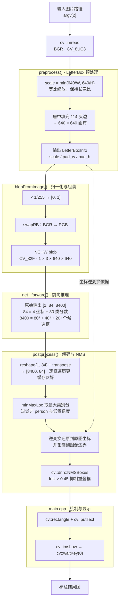

# PedestrianDetectionSystem

> v0.1 —— 基于 **YOLOv8n (ONNX) + OpenCV DNN** 的 C++ 行人检测系统，支持对**单张图片**做检测并可视化结果。

一个从零手写完整推理流水线的学习型项目：不依赖 OpenCV 的高层封装（`DetectionModel`），
LetterBox 预处理、YOLOv8 输出解码、NMS 后处理全部自己实现，适合作为理解「深度学习模型部署」的最小可运行范例。

---

## 目录

- [PedestrianDetectionSystem](#pedestriandetectionsystem)
  - [目录](#目录)
  - [功能特性](#功能特性)
  - [环境依赖](#环境依赖)
  - [快速开始](#快速开始)
    - [1. 编译](#1-编译)
    - [2. 运行](#2-运行)
  - [工作原理](#工作原理)
  - [模型准备](#模型准备)
  - [代码结构](#代码结构)
    - [核心 API](#核心-api)
  - [已知限制与路线图](#已知限制与路线图)
    - [v0.1 当前限制](#v01-当前限制)
    - [v0.2 计划](#v02-计划)
  - [学习资料](#学习资料)
  - [致谢](#致谢)

---

## 功能特性

- **完整手写推理流水线**：LetterBox 预处理 → `blobFromImage` 归一化 → 前向推理 → 输出解码 → NMS 去重 → 结果绘制
- **单类别检测**：只保留 COCO 的 `person` 类（`class_id = 0`），过滤其余 79 类
- **坐标精确还原**：通过 `LetterBoxInfo` 记录缩放/填充量，将 640×640 网络坐标系下的框精确映射回原图
- **可配置阈值**：置信度阈值与 NMS IoU 阈值可在构造时指定（默认 `0.5` / `0.45`）
- **零拷贝优化**：解码阶段用「包裹外部内存的 Mat 头」读取分数，避免逐框拷贝

---

## 环境依赖

| 依赖 | 版本（本项目验证环境） | 说明 |
|---|---|---|
| C++ 标准 | C++17 | `CMakeLists.txt` 中指定 |
| CMake | ≥ 3.10 | |
| OpenCV | 5.1.0（自编译于 `/usr/local`） | 需含 `dnn`、`highgui`、`imgcodecs` 模块 |
| 编译器 | g++ (GCC) | |

> ⚠️ **关于 OpenCV 版本**：本项目实际编译链接的是自编译的 **OpenCV 5.1.0**（`/usr/local/lib/cmake/opencv5`）。
> 系统包管理器安装的 OpenCV 4.6.0（`/usr/include/opencv4`）**未被使用**。
> 若 CMake 找错了版本，请显式指定：
> ```bash
> cmake -S . -B build -DOpenCV_DIR=/usr/local/lib/cmake/opencv5
> ```

模型导出脚本另需 Python 环境（项目自带 `venv/`）：

| 依赖 | 版本 |
|---|---|
| Python | 3.12.3 |
| ultralytics | 8.4.161 |
| torch | 2.14.0 |
| onnx | 1.23.0 |

---

## 快速开始

### 1. 编译

```bash
cmake -S . -B build -DCMAKE_BUILD_TYPE=Release
cmake --build build -j
```

产物：`build/pedestrian_detection_system`

### 2. 运行

```bash
./build/pedestrian_detection_system <模型路径.onnx> <图片路径>
```

例如：

```bash
./build/pedestrian_detection_system models/yolov8n.onnx test.jpg
```

运行后会弹出一个窗口显示标注结果（红框 + `person 0.87` 形式的置信度标签），按任意键关闭。

> **注意**：程序通过 `cv::imshow` 显示结果，需要图形界面环境（X11 / Wayland）。
> 在无头服务器或 SSH 环境中会失败，可改为 `cv::imwrite("result.jpg", image)` 输出到文件。

---

## 工作原理



**几个关键设计点：**

- **为什么要 LetterBox 而不用 `blobFromImage` 直接 resize？**
  `blobFromImage` 内部是**拉伸**而非等比缩放，会破坏长宽比，导致框位置系统性偏移。
  所以先手工等比缩放 + 填充，再让 `blobFromImage` 做一次"尺寸恰好是 640×640"的空 resize。

- **为什么灰边是 114？**
  YOLO 系列训练时的固定填充值，推理端必须与训练端一致。

- **`LetterBoxInfo` 的作用**
  正变换 `x' = x·scale + pad`，逆变换 `x = (x' - pad) / scale`。
  预处理与后处理共享同一个 `lb_info`，这是坐标能精确还原的保证。

---

## 模型准备

仓库已包含导出好的 `models/yolov8n.onnx`（约 12.8 MB），可直接使用，无需重新导出。

如需从 PyTorch 重新导出：

```bash
# 输入: models/face_detection/yolov8n.pt  (ultralytics 官方 COCO 预训练权重)
# 输出: models/yolov8n.onnx              (imgsz=640)
venv/bin/python scripts/export_onnx.py
```

> 目录名 `face_detection/` 与检测用途无关，仅作为权重存放位置；
> 权重为 ultralytics 标准的 COCO 预训练 `yolov8n`（输出 84 = 4 + 80 类，即 COCO 的 80 类，其中 `person` 为 0 号类）。

**输入输出规格：**

| | 形状 | 类型 | 说明 |
|---|---|---|---|
| 输入 | `1 × 3 × 640 × 640` | `CV_32F` | RGB, 归一化到 [0,1] |
| 输出 | `1 × 84 × 8400` | `CV_32F` | 未解码的原始预测头 |

---

## 代码结构

```
PedestrianDetectionSystem/
├── CMakeLists.txt              # 构建配置
├── README.md
├── include/
│   └── PedestrianDetector.hpp  # 类声明：LetterBoxInfo / Detection / PedestrianDetector
├── src/
│   ├── PedestrianDetector.cpp  # 核心实现：preprocess / postprocess / detect
│   └── main.cpp                # 命令行入口：读图 → 检测 → 绘制 → 显示
├── models/
│   ├── yolov8n.onnx            # 推理用 ONNX 模型（12.8 MB）
│   └── face_detection/
│       └── yolov8n.pt          # ultralytics PyTorch 权重（导出源）
├── scripts/
│   └── export_onnx.py          # .pt → .onnx 导出脚本
├── docs/
│   └── opencv-notes.md         # OpenCV 学习笔记（强烈推荐阅读）
├── venv/                       # Python 虚拟环境（模型导出用）
└── build/                      # CMake 构建目录
```

### 核心 API

```cpp
// 构造：传入 ONNX 模型路径与阈值
PedestrianDetector pd("models/yolov8n.onnx",
                      /* conf_threshold = */ 0.5f,
                      /* iou_threshold  = */ 0.45f);

// 检测：返回所有行人框
std::vector<Detection> dets = pd.detect(image);

struct Detection {
    cv::Rect box;          // 原图坐标系下的检测框
    float    confidence;   // 置信度 [0, 1]
    int      class_id;     // 固定为 0 (person)
};
```

---

## 已知限制与路线图

### v0.1 当前限制

| 限制 | 说明 |
|---|---|
| **仅支持单张图片** | 无视频 / 摄像头输入 |
| **仅检测行人** | `person_class_id_` 硬编码为 0，其他类别被过滤 |
| **依赖图形界面** | 结果只能用 `imshow` 显示，无法直接保存到文件 |
| **640 硬编码于三处** | `PedestrianDetector.hpp:34-35`、`PedestrianDetector.cpp:111`、`export_onnx.py:19`，彼此必须一致且**无机制保证** |
| **Debug 构建** | 当前 `build/` 为 Debug 配置，推理速度非最优 |
| **无批处理 / 异步** | `detect()` 为同步单帧接口，未复用 `blob` 缓冲区 |

### v0.2 计划

- [ ] 读取单个视频文件
- [ ] 复用 v0.1 的 YOLO 检测器逐帧检测
- [ ] 每帧绘制检测框
- [ ] 显示检测结果窗口
- [ ] 按 q / ESC 退出
- [ ] 视频结束自动停止
- [ ] 空格暂停 / 继续
- [ ] n 键单帧步进
- [ ] s 键截图保存
- [ ] 跳帧检测：每 N 帧检测一次
- [ ] 显示当前帧号 / 总帧数 / 进度
- [ ] 显示 FPS
- [ ] 显示平均推理耗时
- [ ] 显示检测数量
- [ ] 绘制类别和置信度
- [ ] 保存带框输出视频
- [ ] 保存每帧检测结果 CSV / JSON / TXT
- [ ] 每 N 帧保存原始帧
- [ ] 保存难例：无检测 / 低置信度 / 检测数突变
- [ ] 命令行参数或配置文件：视频路径、模型路径、阈值、输入尺寸、输出路径
- [ ] 置信度 / NMS 阈值可配置
- [ ] 键盘实时调阈值
- [ ] 抽出 VideoSource 或 processVideo()
- [ ] 异常处理：视频打不开、解码失败、读到结尾
- [ ] 分阶段耗时：读取、预处理、推理、后处理、绘制
- [ ] 多线程：读帧 / 推理 / 显示分离
- [ ] 批量处理多个视频
- [ ] ROI 区域检测
- [ ] 简单 IoU 跟踪，给行人加 ID
- [ ] 暂不纳入 v0.2：FFmpeg、Qt、训练模型、多推理后端、复杂跟踪、复杂多线程流水线

---

## 学习资料

**[`docs/opencv-notes.md`](docs/opencv-notes.md)** —— 与本项目配套的 OpenCV 学习笔记，约 6000 字，覆盖本项目用到的全部知识点：

| 章节 | 内容 |
|---|---|
| §1 | `cv::Mat` 内存模型：视图 vs 深拷贝、类型系统、像素访问三种方式 |
| §2-§4 | 图像 I/O、几何变换与 LetterBox 数学、`blobFromImage` 的 5 件事 |
| §5-§7 | DNN 模块（Net / NMSBoxes）、后处理 core 操作、绘图 API |
| §8-§9 | 基础类型速查、**本项目易错点自查清单** |
| §10-§11 | 学习路线、8 道练习题 + 9 道自测题 |

其中 §0 提供了一张「项目代码行号 ↔ OpenCV API ↔ 知识主题」的对照表，是入手的最佳入口。

---

## 致谢

- 模型来自 [Ultralytics YOLOv8](https://github.com/ultralytics/ultralytics)（AGPL-3.0）
- 推理基于 [OpenCV](https://opencv.org/) `dnn` 模块

---

*v0.1 · 单张图片 · 单类别 person · YOLOv8n ONNX + OpenCV DNN*
