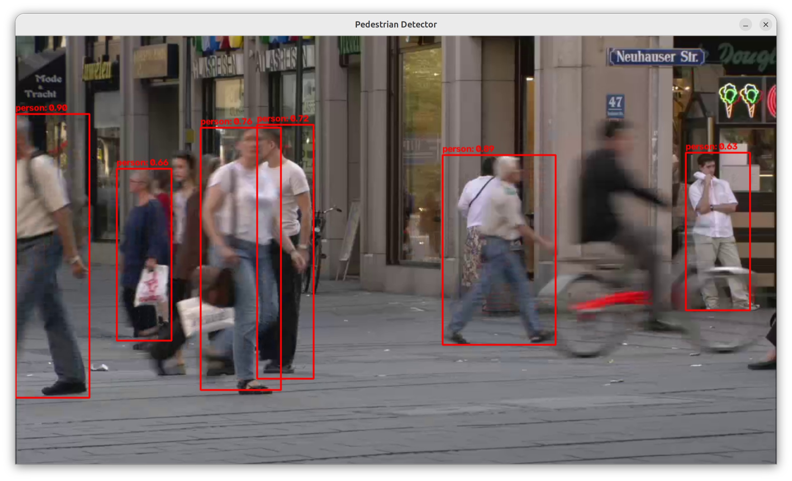

# PedestrianDetectionSystem

基于 YOLOv8n (ONNX) + OpenCV DNN 的 C++ 行人检测系统，支持图片 / 视频输入、无头运行、逐帧 CSV 落盘和分阶段耗时统计。LetterBox、YOLOv8 输出解码、NMS 后处理全部手写，不依赖 `cv::dnn::DetectionModel`。



## 功能

- **图片 / 视频统一输入**：`FrameReader` 抽象接口 + `FrameReaderFactory` 工厂按扩展名自动分派。
- **手写推理流水线**：LetterBox 预处理 → `blobFromImage` → 前向推理 → 输出解码 → NMS → 绘制。
- **单类别检测**：只保留 COCO 的 `person` 类（`class_id = 0`）。
- **DNN 引擎可选**：`--engine auto|new|classic|ort`；启动时打印 OpenCV 版本、请求 / 有效 engine、layers、ORT/CUDA 可用性。
- **无头运行**：`--no-show` 不创建窗口，适用于服务器 / SSH。
- **逐帧 CSV**：`--dump` 写出 `id,x,y,w,h,score`，无检测的帧写哨兵行。
- **分阶段耗时**：`StageTimeTracker` + RAII 计时，输出 `EndToEnd / Read / InferChain / Preprocess / Reason / Postprocess / Draw / DisplayNWait`。
- **冷启动 / 稳态分离**：首帧标记 `Cold Start`，之后为 `Steady State`。

## 环境

| 依赖 | 版本 |
|---|---|
| 系统 | Ubuntu（验证环境 26.04.1 LTS） |
| C++ | C++17 |
| CMake | ≥ 3.10（验证环境 4.4.4） |
| OpenCV | 5.0.0（需含 `dnn` / `highgui` / `imgcodecs` / `videoio`） |
| 编译器 | g++ 15.2.0 |

当前 OpenCV 构建未开启 `WITH_ONNXRUNTIME` / `WITH_CUDA`；引擎限制见 [docs/engine.md](docs/engine.md)。

## 构建

```bash
cmake -S . -B build-release -DCMAKE_BUILD_TYPE=Release
cmake --build build-release -j
```

若 CMake 找不到自编译的 OpenCV 5：

```bash
cmake -S . -B build-release -DCMAKE_BUILD_TYPE=Release \
  -DOpenCV_DIR=/usr/local/lib/cmake/opencv5
```

产物：

- `build-release/pedestrian_detection_system` —— 主程序
- `build-release/smoke_dnn` —— DNN 冒烟测试（CI 调用）

## 运行

源路径可以是图片或视频，程序按扩展名自动识别。

```bash
# 图片
./build-release/pedestrian_detection_system models/yolov8n.onnx 图片路径

# 视频
./build-release/pedestrian_detection_system models/yolov8n.onnx 视频路径

# 无头运行 + CSV
./build-release/pedestrian_detection_system models/yolov8n.onnx 视频路径 \
  --no-show --dump result.csv

# 显式选择推理引擎
./build-release/pedestrian_detection_system models/yolov8n.onnx 视频路径 \
  --engine classic
```

| 选项 | 说明 |
|---|---|
| `-h` / `--help` | 显示用法后退出 |
| `-v` / `--version` | 显示版本号后退出 |
| `--no-show` | 不创建窗口，跳过绘制与 `imshow` |
| `--dump <CSV>` | 逐帧检测结果写入 CSV |
| `--engine <auto / new / classic / ort>` | 选择 DNN engine，默认 `auto`；`OPENCV_FORCE_DNN_ENGINE` 优先；`ort` 在当前构建会回退 AUTO |

按键：`ESC` / `q` / `Q` 退出。

启动时的 `[Engine]` 指纹会打印 requested / env / effective / layers；引擎约束与实测矩阵见 [docs/engine.md](docs/engine.md)。

## 推理流水线

1. **LetterBox**：等比缩放并填充 114 灰边到 640×640，记录 `scale / pad_w / pad_h`。
2. **Blob**：`blobFromImage` 做 `1/255` 归一化、BGR→RGB、NCHW 组装。
3. **Forward**：`cv::dnn::Net::forward()` 得到 `[1, 84, 8400]`。
4. **Decode + NMS**：还原到原图坐标，过滤非 `person`，`cv::dnn::NMSBoxes` 去重。
5. **输出**：窗口绘制、`--dump` 写 CSV，或 `--no-show` 只跑推理链路。

## 性能观测

每帧结束后输出分阶段耗时表；`--no-show` 下没有 `Draw` / `DisplayNWait`。

- 基准输入固定为 `assets/VideoSample.mp4`（1280×720 / 24 fps / 372 帧），参数与 sha256 见 [assets/frozen-test-input.md](assets/frozen-test-input.md)。
- 引擎矩阵、CLASSIC / NEW 的差异和已知限制见 [docs/engine.md](docs/engine.md)。
- 性能数字只在 `Release` 构建、同一输入、同一环境下可比。

## 代码结构

```text
PedestrianDetectionSystem/
├── CMakeLists.txt
├── README.md
├── CHANGELOG.md
├── cliff.toml
├── LICENSE
├── include/
│   ├── DnnEngine.hpp
│   ├── ProjConfig.hpp
│   ├── PedestrianDetector.hpp
│   ├── StageTimeTracker.hpp
│   ├── FrameReader.hpp
│   ├── ImageFrameReader.hpp
│   ├── VideoFrameReader.hpp
│   └── FrameReaderFactory.hpp
├── src/
│   ├── main.cpp
│   ├── PedestrianDetector.cpp
│   ├── StageTimeTracker.cpp
│   ├── ImageFrameReader.cpp
│   ├── VideoFrameReader.cpp
│   └── FrameReaderFactory.cpp
├── models/
│   ├── yolov8n.onnx
│   └── face_detection/yolov8n.pt
├── assets/
│   ├── frozen-test-input.md
│   ├── VideoSample.mp4
│   └── OutputExample.png
├── docs/
│   └── engine.md
├── scripts/
│   ├── export_onnx.py
│   ├── smoke_dnn.cpp
│   └── benchmark_engines.py
└── .github/workflows/ci.yml
```

## 限制

- 当前是单线程 CPU 同步推理；CUDA / ONNXRuntime 未构建。
- 坏帧会让整段输入提前结束，尚无跳过与计数。
- 视频不按源帧率播放。
- 画面没有帧号 / FPS / 进度叠加。
- 输出只有窗口显示与逐帧 CSV，没有带框视频 / 标注图片导出。
- 按键控制只有退出。

## 模型准备

仓库已包含 `models/yolov8n.onnx`，日常运行不需要重新导出。需要重新导出时：

```bash
python3 -m venv venv
venv/bin/pip install ultralytics==8.4.178
venv/bin/python scripts/export_onnx.py
```

输入输出：`1 × 3 × 640 × 640`（RGB，[0,1]）→ `1 × 84 × 8400`。

## License

[AGPL-3.0](LICENSE)

模型来自 [Ultralytics YOLOv8](https://github.com/ultralytics/ultralytics)（AGPL-3.0），推理基于 OpenCV DNN。

变更记录见 [CHANGELOG.md](CHANGELOG.md)。
