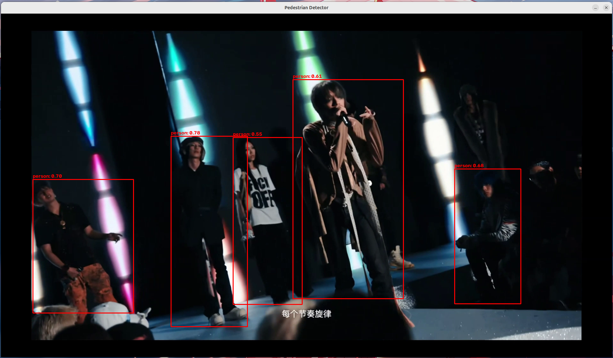
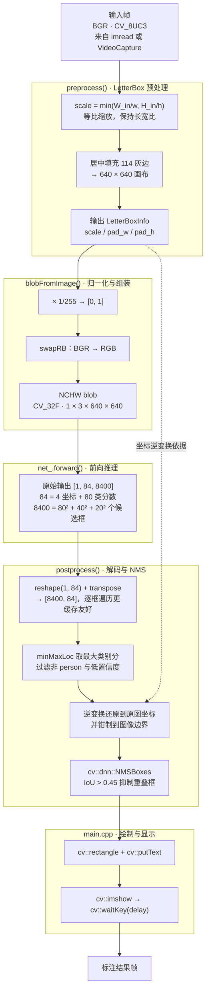

# PedestrianDetectionSystem

> **v0.2.2** —— 基于 **YOLOv8n (ONNX) + OpenCV DNN** 的 C++ 行人检测系统，支持**图片**与**视频**输入，并输出**逐帧分阶段耗时**。

---

一个从零手写完整推理流水线的学习型项目：不依赖 OpenCV 的高层封装（`DetectionModel`），LetterBox 预处理、YOLOv8 输出解码、NMS 后处理全部自己实现。

当前版本在检测能力之上补了两层工程化能力：**统一输入抽象**（`FrameReader` + 工厂）让同一套推理代码同时服务图片和视频；**分阶段性能观测**（`StageTimeTracker` + `ScopedTimer`）用 RAII 记录预处理 / 推理 / 后处理各自耗时 —— 既适合作为理解「深度学习模型部署」的最小可运行范例，也是一个观察设计模式与分阶段计时如何落地的小样本。

---

## 目录

- [PedestrianDetectionSystem](#pedestriandetectionsystem)
  - [目录](#目录)
  - [功能特性](#功能特性)
  - [演示](#演示)
  - [技术栈](#技术栈)
  - [环境依赖](#环境依赖)
  - [安装](#安装)
    - [1. 编译工具](#1-编译工具)
    - [2. OpenCV](#2-opencv)
    - [3. Python 环境（仅重新导出模型时需要）](#3-python-环境仅重新导出模型时需要)
  - [快速开始](#快速开始)
    - [1. 编译](#1-编译)
    - [2. 运行](#2-运行)
    - [3. 按键](#3-按键)
  - [工作原理](#工作原理)
    - [推理流水线（每个输入帧都走一遍）](#推理流水线每个输入帧都走一遍)
  - [性能统计](#性能统计)
  - [模型准备](#模型准备)
  - [代码结构](#代码结构)
  - [能力边界](#能力边界)
    - [当前局限](#当前局限)
    - [暂时不考虑的方向](#暂时不考虑的方向)
  - [更新记录](#更新记录)
  - [贡献](#贡献)
  - [License](#license)
  - [致谢](#致谢)
  - [联系](#联系)

## 功能特性

- **图片 / 视频统一输入**：`FrameReader` 抽象接口 + `FrameReaderFactory` 工厂按扩展名自动分派，`main` 只需一条帧循环
	两者被同一个 `while (fr->read(frame))` 协议统一：`ImageFrameReader::read` 只成功一次（内部 `isUsed_` 标志），`VideoFrameReader::read` 逐帧读到 `VideoCapture` 返回 `false` 为止
- **完整手写推理流水线**：LetterBox 预处理 → `blobFromImage` 归一化 → 前向推理 → 输出解码 → NMS 去重 → 结果绘制
- **单类别检测**：只保留 COCO 的 `person` 类（`class_id = 0`），过滤其余 79 类
- **坐标精确还原**：通过 `LetterBoxInfo` 记录缩放 / 填充量，将 640×640 网络坐标系下的框精确映射回原图
- **集中式配置**：模型路径、源路径、置信度 / NMS 阈值、输入尺寸、类别号统一收敛到 `ProjConfig`
- **模型只加载一次**：`PedestrianDetector` 在帧循环外构造，视频逐帧复用同一个 `cv::dnn::Net`
- **零拷贝解码**：解码阶段用「包裹外部内存的 Mat 头」读取分数，避免逐框拷贝
- **分阶段耗时统计**：`StageTimeTracker` 单例 + RAII 作用域计时（`STAGE_TIME_TRACKER_SCOPE`），逐帧输出「预处理 / 推理 / 后处理」的耗时与占比
- **大分辨率自适应显示**：显示宽度超过 1280 px 时窗口内等比缩小，检测与坐标还原仍在原图分辨率上完成

---

## 演示



输入图片或视频跑一遍的效果：每帧用红框标出行人，框上方的文字是置信度标签 —— 图片与视频共用同一条推理流水线。

## 技术栈

| 层次             | 技术                                       | 在本项目中的用途                                             |
| ---------------- | ------------------------------------------ | ------------------------------------------------------------ |
| 语言 / 标准      | C++17                                      | 全部运行时代码                                               |
| 构建             | CMake 4.4.4（要求 ≥ 3.10）                 | 编译与链接，无额外的第三方构建依赖                           |
| 视觉库           | OpenCV 5.0.0（本机验证）                   | `core` / `imgproc`（LetterBox、绘图）、`imgcodecs`（`imread`）、`videoio`（`VideoCapture`）、`highgui`（`imshow` / `waitKey`） |
| 推理             | OpenCV DNN                                 | `readNetFromONNX` + `forward`，默认 OpenCV 后端 + CPU        |
| 模型             | YOLOv8n（ONNX）                            | ultralytics COCO 预训练权重导出，输入 640×640，输出 `[1, 84, 8400]` |
| 后处理           | 手写实现                                   | 输出解码、LetterBox 坐标逆变换、`cv::dnn::NMSBoxes` 去重     |
| 性能观测         | C++17 `<chrono>` + RAII                    | `ScopedTimer` 作用域计时，`StageTimeTracker` 单例汇总并按帧输出 |
| 模型导出（可选） | Python 3.14 + ultralytics + PyTorch + onnx | 仅在重新导出 ONNX 时用到，不参与运行时                       |

## 环境依赖

| 依赖     | 版本（本项目验证环境） | 说明                                                         |
| -------- | ---------------------- | ------------------------------------------------------------ |
| 系统     | Ubuntu 26.04.1 LTS     | 本项目验证环境                                               |
| C++ 标准 | C++17                  | `CMakeLists.txt` 中指定                                      |
| CMake    | 4.4.4（要求 ≥ 3.10）   |                                                              |
| OpenCV   | 5.0.0                  | 只支持 5.x；需含 `dnn`、`highgui`、`imgcodecs`、**`videoio`** 模块 |
| 编译器   | g++ 15.2.0             |                                                              |

**模型导出脚本另需 Python 环境（本地 `venv/`，已被 `.gitignore` 忽略）：**

| 依赖          | 版本                          |
| ------------- | ----------------------------- |
| Python        | 3.14.4                        |
| ultralytics   | 8.4.178                       |
| torch         | 2.14.1                        |
| onnx          | 导出时由 ultralytics 自动安装 |
| opencv-python | 5.0.0.93                      |

---

## 安装

除 OpenCV 外没有需要下载的第三方 C++ 依赖，装好编译工具与 OpenCV 即可。

### 1. 编译工具

```bash
sudo apt update
sudo apt install -y build-essential cmake
```

### 2. OpenCV

本地验证环境为 OpenCV 5.0.0；CI 固定从源码构建 OpenCV 5.1（见 [.github/workflows/ci.yml](.github/workflows/ci.yml)）

```bash
# OpenCV 5.x 源码：只编译用得到的模块，能显著缩短编译时间
cmake -S <opencv_src> -B <opencv_build> \
      -DCMAKE_BUILD_TYPE=Release \
      -DCMAKE_INSTALL_PREFIX=/usr/local \
      -DBUILD_LIST=core,imgproc,imgcodecs,highgui,videoio,dnn
cmake --build <opencv_build> -j"$(nproc)"
sudo cmake --install <opencv_build>
```

`CMakeLists.txt` 用 `find_package(OpenCV 5 REQUIRED)` 卡大版本号

编译本项目时若 CMake 找到的不是这一份，显式指定路径：

```bash
cmake -S . -B build -DOpenCV_DIR=/usr/local/lib/cmake/opencv5
```

### 3. Python 环境（仅重新导出模型时需要）

仓库已包含导出好的 `models/yolov8n.onnx`，日常使用**不需要**这一步：

```bash
python3 -m venv venv
venv/bin/pip install ultralytics==8.4.178
# PyTorch 作为 ultralytics 的依赖一并安装；
# 首次执行 export_onnx.py 时，ultralytics 会自动安装导出所需的 onnx
```

环境就绪后，继续 [快速开始](#快速开始) 编译并运行。

## 快速开始

### 1. 编译

```bash
cmake -S . -B build -DCMAKE_BUILD_TYPE=Release
cmake --build build -j
```

产物：

- `build/pedestrian_detection_system` —— 主程序
- `build/smoke_dnn` —— 冒烟测试，仅 CI 调用

> `build/` 目录是本地构建产物（不入库）。若之前用它跑过 Debug 配置，重新执行上述命令即可切回 Release；做性能对比前务必确认 `CMAKE_BUILD_TYPE=Release`。

### 2. 运行

```bash
./build/pedestrian_detection_system <模型路径.onnx> <源路径>
```

**源路径可以是图片，也可以是视频** —— 程序按扩展名自动识别（图片：`jpg/jpeg/png/bmp/tif/tiff/webp/ppm/pgm`；视频：`mp4/avi/mov/mkv/flv/wmv/webm/m4v`）。

```bash
# 图片
./build/pedestrian_detection_system models/yolov8n.onnx 图片路径

# 视频
./build/pedestrian_detection_system models/yolov8n.onnx 视频路径
```

- **图片模式**：弹窗显示标注结果，按 ESC 或任意键后程序结束。
- **视频模式**：逐帧检测并实时显示（红框 + `person: 0.87` 形式的置信度标签），按 **ESC** 提前退出，视频播完自动结束。
- **终端报表**：每帧结束后打印三阶段耗时表（见[性能统计](#性能统计)），与显示窗口相互独立。
- **显示缩放**：源画面宽度超过 1280 px 时，窗口内等比缩小；检测框坐标仍基于原图，不受影响。

> **注意**：程序通过 `cv::imshow` 显示结果，需要图形界面环境（X11 / Wayland）。
>
> 在无头服务器或 SSH 环境中会失败，可改为 `cv::imwrite("result.jpg", frame)` 输出到文件。

### 3. 按键

| 按键              | 行为                                 |
| ----------------- | ------------------------------------ |
| `ESC` / `q` / `Q` | 退出（图片模式下任意键都会结束等待） |

> 后续功能的扩展详见 [docs/roadmap.md](docs/roadmap.md)。

---

## 工作原理

### 推理流水线（每个输入帧都走一遍）



> 三个阶段在 `PedestrianDetector::detect()` 中分别被 `STAGE_TIME_TRACKER_SCOPE(...)` 包裹；计时只覆盖推理链路本身，绘制、`imshow` 与 `waitKey` 不计入。

---

## 性能统计

每个输入帧走完 `detect()` 后，终端会打印一张分阶段耗时表：

```text
vX.Y.Z Performance Metrics Report
Stage          Total(ms)   Avg(ms)     Ratio
预处理         12.34       12.34       8.21%
推理           131.56      131.56      87.52%
后处理         6.42        6.42        4.27%
Total Time Spent: 150.32
```

- **实现方式**：`ScopedTimer` 构造时记录 `steady_clock` 起点，析构时把耗时交给 `StageTimeTracker` 单例；`STAGE_TIME_TRACKER_SCOPE("名称")` 宏在作用域内创建计时器，异常路径也能正确结算。
- **统计窗口**：报表在每帧 `detect()` 结束后打印并清空，因此 `Total` 与 `Avg` 在同一帧内相等，`Ratio` 表示三个阶段之间的占比 —— 它回答的是「这一帧的时间花在哪」，不是整段视频的累计值或 FPS。
- **读数的前提**：只在 `CMAKE_BUILD_TYPE=Release` 下有参考价值，Debug 构建的数字会被未优化代码显著放大。做优化前后对比时先固定构建类型，再看「推理」一栏。

---

## 模型准备

仓库已包含导出好的 `models/yolov8n.onnx`（约 12.8 MB），可直接使用，无需重新导出。

如需从 PyTorch 重新导出：

```bash
# 输入: models/face_detection/yolov8n.pt  (ultralytics 官方 COCO 预训练权重)
# 输出: models/yolov8n.onnx              (imgsz=640)
venv/bin/python scripts/export_onnx.py
```

> 目录名 `face_detection/` 与检测用途无关，仅作为权重存放位置；权重为 ultralytics 标准的 COCO 预训练 `yolov8n`（输出 84 = 4 + 80 类，即 COCO 的 80 类，其中 `person` 为 0 号类）。

**输入输出规格：**

|      | 形状                | 类型     | 说明                |
| ---- | ------------------- | -------- | ------------------- |
| 输入 | `1 × 3 × 640 × 640` | `CV_32F` | RGB, 归一化到 [0,1] |
| 输出 | `1 × 84 × 8400`     | `CV_32F` | 未解码的原始预测头  |

> ⚠️ 输入尺寸 `640` 需三处同步：`ProjConfig::input_width/input_height`、letterbox 画布、`export_onnx.py` 的 `imgsz`。无机制保证，改时手动核对 —— 冒烟测试会校验输出形状 `[1, 84, 8400]`，不同步则 CI 直接失败。

---

## 代码结构

```
PedestrianDetectionSystem/
├── CMakeLists.txt                  # 构建配置（版本号真源）
├── README.md
├── CHANGELOG.md                    # 更新记录（git-cliff 生成，勿手改）
├── cliff.toml                      # git-cliff 配置
├── LICENSE                         # AGPL-3.0 全文
├── include/
│   ├── ProjConfig.hpp              # 集中配置：路径 / 阈值 / 输入尺寸 / 类别号
│   ├── PedestrianDetector.hpp      # 检测器：LetterBoxInfo / Detection / PedestrianDetector
│   ├── StageTimeTracker.hpp        # 【性能观测】ScopedTimer + 单例汇总 + 计时宏
│   ├── FrameReader.hpp             # 【抽象接口】open / read / release / isOpened
│   ├── ImageFrameReader.hpp        # 图片源：一次性读取（isUsed_ 标志）
│   ├── VideoFrameReader.hpp        # 视频源：封装 cv::VideoCapture，逐帧读取
│   └── FrameReaderFactory.hpp      # 工厂：detectSourceType + createFrameReader
├── src/
│   ├── main.cpp                    # 装配与帧循环：检测 → 绘制 → 输出耗时 → 显示
│   ├── PedestrianDetector.cpp      # 核心实现：preprocess / postprocess / detect（含三阶段计时）
│   ├── StageTimeTracker.cpp        # 分阶段计时汇总、按帧输出报表
│   ├── ImageFrameReader.cpp
│   ├── VideoFrameReader.cpp
│   └── FrameReaderFactory.cpp      # 扩展名表 + switch 创建
├── models/
│   ├── yolov8n.onnx                # 推理用 ONNX 模型（12.8 MB）
│   └── face_detection/
│       └── yolov8n.pt              # ultralytics PyTorch 权重（导出源）
├── scripts/
│   ├── export_onnx.py              # .pt → .onnx 导出脚本
│   ├── smoke_dnn.cpp               # DNN 冒烟测试：ONNX 加载 → 前向 → 校验 [1,84,8400]（CI 调用）
│   ├── check_version.py            # 版本号一致性校验（CI 调用）
│   └── check_links.py              # 文档链接与锚点校验（CI 调用）
├── docs/
│   ├── roadmap.md                  # 路线图：方向性说明（粗粒度，非承诺）
│   └── PDExample.png               # 演示截图（README「演示」节引用）
├── .github/workflows/ci.yml        # CI：编译 + 冒烟 + 版本号一致性 + 文档链接
├── venv/                           # Python 虚拟环境（本地，不入库）
└── build/                          # CMake 构建目录（本地，不入库）
```

---

## 能力边界

### 当前局限

这一版仍是单线程 CPU 同步推理。以下是已知未解的问题，修复方向见 [docs/roadmap.md](docs/roadmap.md)：

- 坏帧会让程序终止（无异常防护）
- 视频不按原速播放
- 无帧号 / 播放进度 / 实时 FPS（仅终端输出三阶段耗时，未做端到端帧率统计）
- 结果只能经 `cv::imshow` 显示，无头环境不可用
- 按键控制少：无暂停 / 单帧步进 / 截图

### 暂时不考虑的方向

先聚焦主线：对推理流水线继续完善。以下方向当前主动不纳入，条件变了会重新评估：

- FFmpeg / GStreamer 解码
- Qt 或其他 GUI 框架
- 训练 / 微调模型
- 多推理后端（TensorRT / OpenVINO / ONNX Runtime）
- 复杂跟踪（SORT / DeepSORT）
- 复杂多线程流水线

---

## 更新记录

各版本的完整变更见 **[CHANGELOG.md](CHANGELOG.md)** —— 由 [git-cliff](https://git-cliff.org/) 从提交历史自动生成，不手工维护。

后续迭代方向见 **[docs/roadmap.md](docs/roadmap.md)** —— 方向性文档（粗粒度、非承诺），只说"往哪走"，不列具体任务与排期。

---

## 贡献

欢迎提交 Issue 和 Pull Request。

提交信息遵循 [Conventional Commits](https://www.conventionalcommits.org/)（`feat:` / `fix:` / `docs:` / `refactor:` …）：[CHANGELOG.md](CHANGELOG.md) 由它自动生成，也是版本号自动推断的依据。

发版流程写在 [cliff.toml](cliff.toml) 顶部注释里；CI（编译 + 冒烟 + 版本号一致性 + 文档链接）见 [.github/workflows/ci.yml](.github/workflows/ci.yml)。

---

## License

本项目以 **GNU Affero General Public License v3.0（AGPL-3.0）** 发布，全文见 [LICENSE](./LICENSE)。

---

## 致谢

- 模型来自 [Ultralytics YOLOv8](https://github.com/ultralytics/ultralytics)（AGPL-3.0）
- 推理基于 [OpenCV](https://opencv.org/) `dnn` / `videoio` 模块

---

## 联系

邮箱：joireveyuan@gmail.com

---

*图片 + 视频 · 单类别 person · YOLOv8n ONNX + OpenCV DNN*