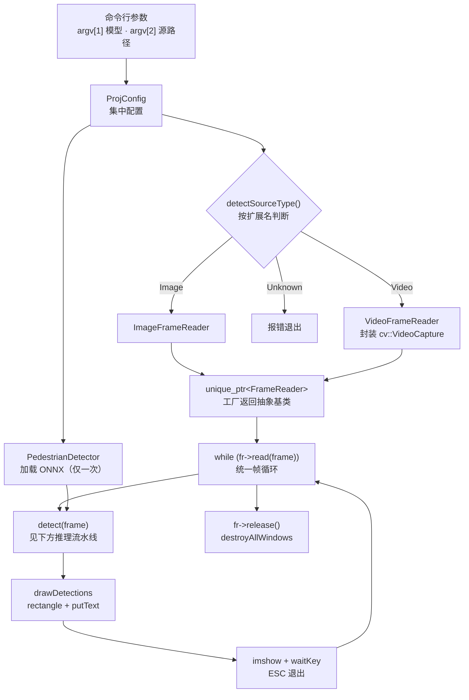
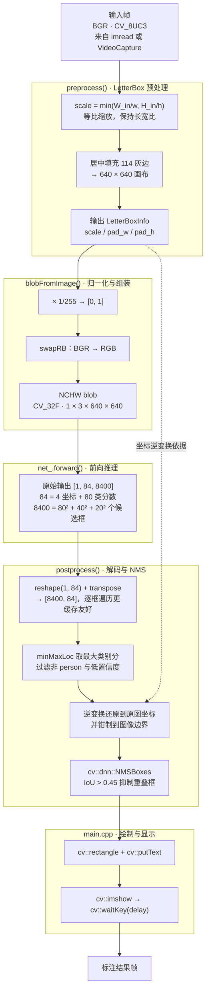
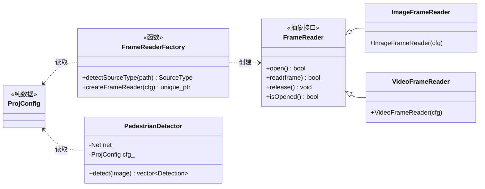

# PedestrianDetectionSystem

> **v0.2.0** —— 基于 **YOLOv8n (ONNX) + OpenCV DNN** 的 C++ 行人检测系统，支持**图片**与**视频**输入。

---

一个从零手写完整推理流水线的学习型项目：不依赖 OpenCV 的高层封装（`DetectionModel`），LetterBox 预处理、YOLOv8 输出解码、NMS 后处理全部自己实现。

v0.2 在检测能力之上补了一层**统一输入抽象**（`FrameReader` + 工厂），让同一套推理代码同时服务图片和视频 —— 既适合作为理解「深度学习模型部署」的最小可运行范例，也是一个观察设计模式如何落地的小样本。

---

## 目录

- [PedestrianDetectionSystem](#pedestriandetectionsystem)
  - [目录](#目录)
  - [功能特性](#功能特性)
  - [演示](#演示)
  - [技术栈](#技术栈)
  - [环境依赖](#环境依赖)
  - [安装](#安装)
    - [1. 编译工具](#1-编译工具)
    - [2. OpenCV](#2-opencv)
    - [3. Python 环境（仅重新导出模型时需要）](#3-python-环境仅重新导出模型时需要)
  - [快速开始](#快速开始)
    - [1. 编译](#1-编译)
    - [2. 运行](#2-运行)
    - [3. 按键](#3-按键)
  - [工作原理](#工作原理)
    - [整体数据流](#整体数据流)
    - [推理流水线（每个输入帧都走一遍）](#推理流水线每个输入帧都走一遍)
    - [几个关键设计点](#几个关键设计点)
  - [模型准备](#模型准备)
  - [代码结构](#代码结构)
    - [类关系](#类关系)
    - [核心 API](#核心-api)
  - [能力边界](#能力边界)
    - [当前局限](#当前局限)
    - [暂时不考虑的方向](#暂时不考虑的方向)
    - [下一步](#下一步)
  - [学习资料](#学习资料)
  - [更新记录](#更新记录)
  - [贡献](#贡献)
  - [License](#license)
  - [致谢](#致谢)
  - [联系](#联系)

---

## 功能特性

- **图片 / 视频统一输入**：`FrameReader` 抽象接口 + `FrameReaderFactory` 工厂按扩展名自动分派，`main` 只需一条帧循环
- **完整手写推理流水线**：LetterBox 预处理 → `blobFromImage` 归一化 → 前向推理 → 输出解码 → NMS 去重 → 结果绘制
- **单类别检测**：只保留 COCO 的 `person` 类（`class_id = 0`），过滤其余 79 类
- **坐标精确还原**：通过 `LetterBoxInfo` 记录缩放 / 填充量，将 640×640 网络坐标系下的框精确映射回原图
- **集中式配置**：模型路径、源路径、置信度 / NMS 阈值、输入尺寸、类别号统一收敛到 `ProjConfig`
- **模型只加载一次**：`PedestrianDetector` 在帧循环外构造，视频逐帧复用同一个 `cv::dnn::Net`
- **零拷贝解码**：解码阶段用「包裹外部内存的 Mat 头」读取分数，避免逐框拷贝

---

## 演示


输入图片或视频跑一遍的效果：每帧用红框标出行人，框上方的文字是置信度标签 —— 图片与视频共用同一条推理流水线。

## 技术栈

| 层次             | 技术                                       | 在本项目中的用途                                             |
| ---------------- | ------------------------------------------ | ------------------------------------------------------------ |
| 语言 / 标准      | C++17                                      | 全部运行时代码                                               |
| 构建             | CMake ≥ 3.10                               | 编译与链接，无额外的第三方构建依赖                           |
| 视觉库           | OpenCV 5.1.0                               | `core` / `imgproc`（LetterBox、绘图）、`imgcodecs`（`imread`）、`videoio`（`VideoCapture`）、`highgui`（`imshow` / `waitKey`） |
| 推理             | OpenCV DNN                                 | `readNetFromONNX` + `forward`，默认 OpenCV 后端 + CPU        |
| 模型             | YOLOv8n（ONNX）                            | ultralytics COCO 预训练权重导出，输入 640×640，输出 `[1, 84, 8400]` |
| 后处理           | 手写实现                                   | 输出解码、LetterBox 坐标逆变换、`cv::dnn::NMSBoxes` 去重     |
| 模型导出（可选） | Python 3.12 + ultralytics + PyTorch + onnx | 仅在重新导出 ONNX 时用到，不参与运行时                       |

## 环境依赖

| 依赖     | 版本（本项目验证环境）         | 说明                                                   |
| -------- | ------------------------------ | ------------------------------------------------------ |
| C++ 标准 | C++17                          | `CMakeLists.txt` 中指定                                |
| CMake    | ≥ 3.10                         |                                                        |
| OpenCV   | 5.1.0（自编译于 `/usr/local`） | 需含 `dnn`、`highgui`、`imgcodecs`、**`videoio`** 模块 |
| 编译器   | g++ (GCC)                      |                                                        |

> ⚠️ **关于 OpenCV 版本**：本项目实际编译链接的是自编译的 **OpenCV 5.1.0**（`/usr/local/lib/cmake/opencv5`）。
> 系统包管理器安装的 OpenCV 4.6.0（`/usr/include/opencv4`）**未被使用**。
> 若 CMake 找错了版本，请显式指定：
>
> ```bash
> cmake -S . -B build -DOpenCV_DIR=/usr/local/lib/cmake/opencv5
> ```

模型导出脚本另需 Python 环境（项目自带 `venv/`）：

| 依赖        | 版本    |
| ----------- | ------- |
| Python      | 3.12.3  |
| ultralytics | 8.4.161 |
| torch       | 2.14.0  |
| onnx        | 1.23.0  |

---

## 安装

除 OpenCV 外没有需要下载的第三方 C++ 依赖，装好编译工具与 OpenCV 即可。

### 1. 编译工具

```bash
sudo apt update
sudo apt install -y build-essential cmake
```

### 2. OpenCV

需要含 `dnn`、`imgcodecs`、`videoio`、`highgui` 模块的 OpenCV。本项目在**自编译的 OpenCV 5.1.0**（安装到 `/usr/local`）上验证：

```bash
# 以 OpenCV 5.x 源码为例：只编译用得到的模块，能显著缩短编译时间
cmake -S <opencv_src> -B <opencv_build> \
      -DCMAKE_BUILD_TYPE=Release \
      -DCMAKE_INSTALL_PREFIX=/usr/local \
      -DBUILD_LIST=core,imgproc,imgcodecs,highgui,videoio,dnn
cmake --build <opencv_build> -j"$(nproc)"
sudo cmake --install <opencv_build>
```

编译本项目时若 CMake 找到的不是这一份，显式指定路径：

```bash
cmake -S . -B build -DOpenCV_DIR=/usr/local/lib/cmake/opencv5
```

> 发行版自带的 OpenCV 4.x（`sudo apt install libopencv-dev`）API 兼容、通常也能编译通过，但不是本项目的实测环境 —— 见[环境依赖](#环境依赖)的版本说明。

### 3. Python 环境（仅重新导出模型时需要）

仓库已包含导出好的 `models/yolov8n.onnx`，日常使用**不需要**这一步：

```bash
python3 -m venv venv
venv/bin/pip install ultralytics==8.4.161 onnx==1.23.0   # PyTorch 作为 ultralytics 的依赖一并安装
```

环境就绪后，继续 [快速开始](#快速开始) 编译并运行。

## 快速开始

### 1. 编译

```bash
cmake -S . -B build -DCMAKE_BUILD_TYPE=Release
cmake --build build -j
```

产物：`build/pedestrian_detection_system`

> 当前 `build/` 缓存是 **Debug** 配置（`CMAKE_BUILD_TYPE=Debug`），推理速度非最优。
> 做性能对比前先切 Release：`cmake -S . -B build -DCMAKE_BUILD_TYPE=Release && cmake --build build -j`。

### 2. 运行

```bash
./build/pedestrian_detection_system <模型路径.onnx> <源路径>
```

**源路径可以是图片，也可以是视频** —— 程序按扩展名自动识别（图片：`jpg/jpeg/png/bmp/tif/tiff/webp/ppm/pgm`；视频：`mp4/avi/mov/mkv/flv/wmv/webm/m4v`）。

```bash
# 图片
./build/pedestrian_detection_system models/yolov8n.onnx 图片路径

# 视频
./build/pedestrian_detection_system models/yolov8n.onnx 视频路径
```

- **图片模式**：弹窗显示标注结果，按 ESC 或任意键后程序结束。
- **视频模式**：逐帧检测并实时显示（红框 + `person: 0.87` 形式的置信度标签），按 **ESC** 提前退出，视频播完自动结束。

> **注意**：程序通过 `cv::imshow` 显示结果，需要图形界面环境（X11 / Wayland）。
> 在无头服务器或 SSH 环境中会失败，可改为 `cv::imwrite("result.jpg", frame)` 输出到文件。

### 3. 按键

| 按键  | 行为                                 |
| ----- | ------------------------------------ |
| `ESC` | 退出（图片模式下任意键都会结束等待） |

> `q` 键退出、暂停 / 单帧步进 / 截图都排在后面的方向里（见 [docs/roadmap.md](docs/roadmap.md)）。

---

## 工作原理

### 整体数据流



**图片和视频的差别被完全关在了工厂内部**：`main` 拿到的只是一个 `FrameReader`，调用同样的 `open/read/release`。
`ImageFrameReader::read` 只成功一次（内部 `isUsed_` 标志），`VideoFrameReader::read` 一帧一帧读到 `VideoCapture` 返回 `false` 为止 —— 两者都被 `while (fr->read(frame))` 这一个协议统一。

### 推理流水线（每个输入帧都走一遍）



### 几个关键设计点

- **为什么要 LetterBox 而不用 `blobFromImage` 直接 resize？**
	`blobFromImage` 内部是**拉伸**而非等比缩放，会破坏长宽比，导致框位置系统性偏移。
	所以先手工等比缩放 + 填充，再让 `blobFromImage` 做一次"尺寸恰好是 640×640"的空 resize。

- **为什么灰边是 114？**
	YOLO 系列训练时的固定填充值，推理端必须与训练端一致。

- **`LetterBoxInfo` 的作用**
	正变换 `x' = x·scale + pad`，逆变换 `x = (x' - pad) / scale`。
	预处理与后处理共享同一个 `lb_info`，这是坐标能精确还原的保证。

- **模型为什么只加载一次？**
	`readNetFromONNX` 会解析计算图 + 载入权重，是**数百毫秒级**的开销；
	视频模式下把它放在帧循环**之外**（`main` 在进入 `while (fr->read(frame))` 之前构造 `PedestrianDetector`）是性能上的必要选择。

- **视频每帧都要重建 letterbox 画布和 blob**，这是当前的主要开销点之一；
	同一视频的 `scale/pad` 恒定，具备"算一次、用 N 帧"的优化空间（属于性能方向，见 [docs/roadmap.md](docs/roadmap.md)）。

---

## 模型准备

仓库已包含导出好的 `models/yolov8n.onnx`（约 12.8 MB），可直接使用，无需重新导出。

如需从 PyTorch 重新导出：

```bash
# 输入: models/face_detection/yolov8n.pt  (ultralytics 官方 COCO 预训练权重)
# 输出: models/yolov8n.onnx              (imgsz=640)
venv/bin/python scripts/export_onnx.py
```

> 目录名 `face_detection/` 与检测用途无关，仅作为权重存放位置；
> 权重为 ultralytics 标准的 COCO 预训练 `yolov8n`（输出 84 = 4 + 80 类，即 COCO 的 80 类，其中 `person` 为 0 号类）。

**输入输出规格：**

|      | 形状                | 类型     | 说明                |
| ---- | ------------------- | -------- | ------------------- |
| 输入 | `1 × 3 × 640 × 640` | `CV_32F` | RGB, 归一化到 [0,1] |
| 输出 | `1 × 84 × 8400`     | `CV_32F` | 未解码的原始预测头  |

> ⚠️ 输入尺寸 `640` 需要与三处保持一致：`ProjConfig::input_width/input_height`（代码侧）、letterbox 画布尺寸（由 config 派生）、`export_onnx.py` 的 `imgsz`（导出侧）。目前**没有机制保证**三者同步，改模型输入尺寸时务必手动核对。

---

## 代码结构

```
PedestrianDetectionSystem/
├── CMakeLists.txt                  # 构建配置
├── README.md
├── PDExample.png                   # 演示截图（README「演示」节引用）
├── LICENSE                         # AGPL-3.0 全文
├── include/
│   ├── ProjConfig.hpp              # 集中配置：路径 / 阈值 / 输入尺寸 / 类别号
│   ├── PedestrianDetector.hpp      # 检测器：LetterBoxInfo / Detection / PedestrianDetector
│   ├── FrameReader.hpp             # 【抽象接口】open / read / release / isOpened
│   ├── ImageFrameReader.hpp        # 图片源：一次性读取（isUsed_ 标志）
│   ├── VideoFrameReader.hpp        # 视频源：封装 cv::VideoCapture，逐帧读取
│   └── FrameReaderFactory.hpp      # 工厂：detectSourceType + createFrameReader
├── src/
│   ├── main.cpp                    # 装配与帧循环：创建 → 打开 → 循环检测绘制显示
│   ├── PedestrianDetector.cpp      # 核心实现：preprocess / postprocess / detect
│   ├── ImageFrameReader.cpp
│   ├── VideoFrameReader.cpp
│   └── FrameReaderFactory.cpp      # 扩展名表 + switch 创建
├── models/
│   ├── yolov8n.onnx                # 推理用 ONNX 模型（12.8 MB）
│   └── face_detection/
│       └── yolov8n.pt              # ultralytics PyTorch 权重（导出源）
├── scripts/
│   └── export_onnx.py              # .pt → .onnx 导出脚本
├── docs/                           # 学习笔记（强烈推荐阅读）
│   ├── opencv-notes.md             # OpenCV：Mat / I/O / 几何变换 / DNN / VideoCapture
│   ├── factory-pattern.md          # 设计模式：工厂模式（FrameReaderFactory 实例）
│   ├── cpp-oop-notes.md            # C++：接口 / 多态 / RAII / 所有权
│   └── roadmap.md                  # 路线图：方向性说明（粗粒度，非承诺）
├── venv/                           # Python 虚拟环境（模型导出用）
└── build/                          # CMake 构建目录
```

### 类关系



### 核心 API

**配置**

```cpp
struct ProjConfig {
    std::string model_path;              // ONNX 模型路径
    std::string source_path;             // 图片或视频路径

    float conf_threshold = 0.5f;         // 调高：漏检多、误检少；调低：漏检少、误检多
    float iou_threshold  = 0.45f;        // 调高：保留更多重叠框；调低：合并得更激进

    int input_width  = 640;              // 必须与 ONNX 导出时的 imgsz 一致
    int input_height = 640;

    int person_class_id = 0;             // COCO 中 person 为 0 号类
};
```

**检测器**

```cpp
// 构造：加载 ONNX（较慢，务必只构造一次），并拷贝一份配置
PedestrianDetector pd(cfg);

// 检测：返回当前帧中的所有行人框
std::vector<Detection> dets = pd.detect(image);

struct Detection {
    cv::Rect box;          // 原图坐标系下的检测框
    float    confidence;   // 置信度 [0, 1]
    int      class_id;     // 固定为 0 (person)
};
```

**输入源（工厂 + 抽象接口）**

```cpp
// 按扩展名判类型；无法识别时返回 SourceType::Unknown
SourceType type = detectSourceType(cfg.source_path);

// 创建对应 Reader；类型无法识别时抛 std::invalid_argument
std::unique_ptr<FrameReader> fr = createFrameReader(cfg);

// 统一的使用协议 —— 图片与视频完全相同
if (!fr->open()) { /* 处理失败 */ }
cv::Mat frame;
while (fr->read(frame)) {          // 视频读到结尾 / 图片读完 → false，循环自然结束
    auto dets = pd.detect(frame);
    // ...
}
fr->release();
```

---

## 能力边界

### 当前局限

> 这一节只说明目前存在的问题和缺陷，功能请见上方[功能特性](#功能特性)。
> 	后续迭代的方向见 **[docs/roadmap.md](docs/roadmap.md)** —— 具体任务与排期不在这里维护。

以下为 **v0.2.0** 的现状：

| 限制                        | 说明                                                         |
| --------------------------- | ------------------------------------------------------------ |
| **坏图会让程序崩溃**        | `ImageFrameReader::read` 未检查 `imread` 的空图，空帧一路带到 `PedestrianDetector::preprocess` 抛异常，而帧循环没有 `try/catch` → `std::terminate` |
| **帧循环无异常防护**        | `PedestrianDetector::detect` 抛出的任何异常都会终止程序，而不是跳过当前帧 |
| **视频不按原速播放**        | 帧间隔固定 `waitKey(1)`，语义是"尽快解码"；高分辨率视频会明显快放、掉节奏 |
| **无任何状态显示**          | 没有帧号 / 总帧数 / 进度 / FPS / 推理耗时                    |
| **Reader 未暴露视频元信息** | `FrameReader` 没有 `fps()` / `frameCount()` / 帧号一类接口，`main` 想知道只能自己去问 `SourceType` |
| **按键控制极少**            | 只有 ESC 退出；`q` 键未实现，无暂停 / 单帧步进 / 截图        |
| **依赖图形界面**            | 结果只能用 `cv::imshow` 显示，无法保存为图片或视频           |
| **输入尺寸三处需手动同步**  | `ProjConfig::input_width/input_height`、letterbox 画布、`export_onnx.py` 的 `imgsz`，无机制保证一致 |
| **每帧重复分配与计算**      | letterbox 画布、blob、transpose 每帧重建；`scale/pad` 每帧重算（同一视频内恒定） |
| **无跳帧 / 多线程 / 跟踪**  | 逐帧同步推理，无流水线并行，无行人 ID                        |
| **Debug 构建**              | `build/` 当前是 Debug 配置，推理速度非最优                   |
| **仅 CPU 推理**             | `setPreferableBackend/Target` 被注释，走默认 OpenCV 后端 + CPU |

### 暂时不考虑的方向

先聚焦主线：对推理流水线继续完善。以下方向当前主动不纳入，条件变了会重新评估：

- FFmpeg / GStreamer 解码
- Qt 或其他 GUI 框架
- 训练 / 微调模型
- 多推理后端（TensorRT / OpenVINO / ONNX Runtime）
- 复杂跟踪（SORT / DeepSORT）
- 复杂多线程流水线

### 下一步

重心仍是**把现有能力做扎实**：先补健壮性与播放节奏（坏帧不再终止程序、帧间隔贴合源本身、画面能看见进度），再补播放控制与输出管道（暂停 / 步进 / 截图、结果落盘），性能与输入源扩展排在后面。

方向与排序见 **[docs/roadmap.md](docs/roadmap.md)**；具体任务与排期不在这里维护。

---

## 学习资料

`docs/` 下是随项目一起迭代的**模块知识笔记**：不同模块对应不同的文件，各自独立更新。

| 文档                                                   | 内容                                                         | 适合                           |
| ------------------------------------------------------ | ------------------------------------------------------------ | ------------------------------ |
| **[docs/opencv-notes.md](docs/opencv-notes.md)**       | OpenCV 全部知识点：`cv::Mat` 内存模型、图像/视频 I/O（`imread`、`VideoCapture`）、HighGUI 帧循环、几何变换与 LetterBox 数学、`blobFromImage`、DNN 模块、绘图 API；附易错点自查清单、13 道练习、14 道自测题 | 边写边查，建立 OpenCV 主干知识 |
| **[docs/factory-pattern.md](docs/factory-pattern.md)** | 工厂模式：为什么需要、本项目的 `FrameReaderFactory` 走读、简单工厂 / 工厂方法 / 抽象工厂对比、扩展新输入源的步骤、注册表进阶写法、7 条常见坑 | 想搞懂"这层抽象到底值不值"     |
| **[docs/cpp-oop-notes.md](docs/cpp-oop-notes.md)**     | C++ 语言与设计：抽象接口、虚函数与多态、虚析构为什么必须有、`unique_ptr` 所有权、RAII 与 `release()` 的关系、值语义 vs 指针语义、设计原则对照 | 补 C++ 面向对象的地基          |

> 每个笔记内部都有「§0 总览：项目代码 ↔ 知识点」的对照表，以及 `更新记录` 小节 —— 随代码迭代同步维护。
>
> 另有 **[docs/roadmap.md](docs/roadmap.md)** —— 方向性文档（粗粒度、非承诺），只说"往哪走"，不列具体任务与排期。

---

## 更新记录

| 版本                 | 内容                                                         |
| -------------------- | ------------------------------------------------------------ |
| **v0.2.1**（进行中） | 打磨版：修复空图崩溃与帧循环异常防护；帧间隔改由 `FrameReader::frameDelayMs()` 决定（按原生 FPS 播放）；新增 `q` 退出与帧号 / FPS 叠加显示；`release()` 下沉析构 |
| **v0.2.0**           | 统一输入抽象：新增 `FrameReader` 接口 + `ImageFrameReader` / `VideoFrameReader` 实现 + `FrameReaderFactory` 工厂；`main` 改为统一帧循环（图片 / 视频共用）；新增 `ProjConfig` 集中配置；新增视频模块笔记与两份配套知识笔记 |
| **v0.1**             | 单张图片检测：手写 LetterBox → `blobFromImage` → 前向推理 → 输出解码 → NMS → 绘制显示 的完整流水线 |

---

## 贡献

欢迎提交 Issue 和 Pull Request。

---

## License

本项目以 **GNU Affero General Public License v3.0（AGPL-3.0）** 发布，全文见 [LICENSE](./LICENSE)。

---

## 致谢

- 模型来自 [Ultralytics YOLOv8](https://github.com/ultralytics/ultralytics)（AGPL-3.0）
- 推理基于 [OpenCV](https://opencv.org/) `dnn` / `videoio` 模块

---

## 联系

邮箱：joireveyuan@gmail.com

---

*v0.2.0 · 图片 + 视频 · 单类别 person · YOLOv8n ONNX + OpenCV DNN*（v0.2.1 打磨中）