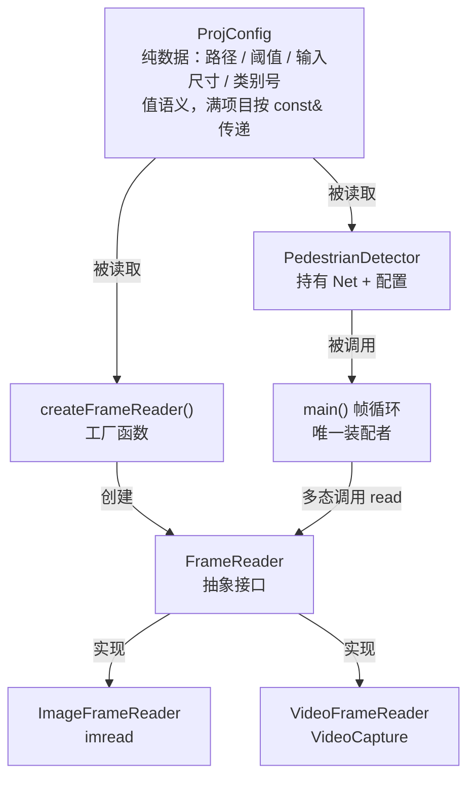
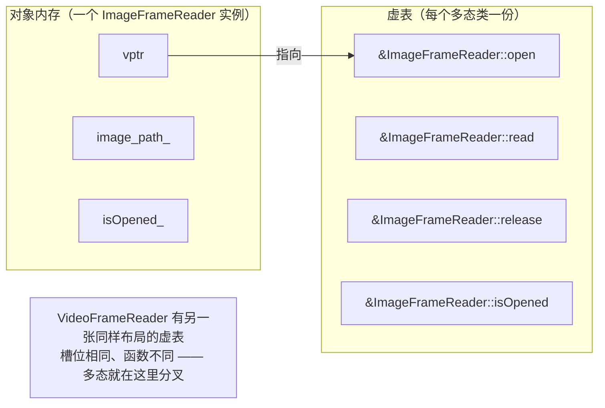
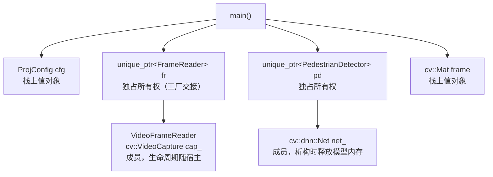

# C++ 笔记 · 接口 / 多态 / RAII

> 配套项目：PedestrianDetectionSystem **v0.2.0** · **v0.2.1 打磨中**
> 相关文档：[README.md](../README.md)（项目说明）· [opencv-notes.md](opencv-notes.md)（OpenCV 知识点）· [factory-pattern.md](factory-pattern.md)（工厂模式）
> 本文只讲**不依赖 OpenCV 的 C++ 语言与设计知识**：抽象接口怎么写、多态怎么跑、资源由谁释放、配置怎么传。
> 素材全部来自本项目 v0.2 新增的 `FrameReader` 一族。文中行号对应本仓库当前源码，随版本迭代同步更新。

## 目录

- [§1 本项目的类全景](#1-本项目的类全景)
- [§2 抽象基类与接口](#2-抽象基类与接口)
- [§3 虚函数与多态](#3-虚函数与多态)
- [§4 虚析构函数：为什么"必须有"](#4-虚析构函数为什么必须有)
- [§5 所有权、RAII 与智能指针](#5-所有权raii-与智能指针)
- [§6 配置对象的传递：值语义、const 与生命周期](#6-配置对象的传递值语义const-与生命周期)
- [§7 设计原则对照](#7-设计原则对照)
- [§8 自查清单](#8-自查清单)
- [§9 练习与自测题](#9-练习与自测题)
- [更新记录](#更新记录)

---

## §1 本项目的类全景



**分层很干净**：输入（Reader 族）→ 推理（Detector）→ 装配与展示（main）。
每一层只依赖下一层的**抽象**，没有一个类需要知道另一个类的内部细节。

| 文件 | 语言知识点密度 |
|---|---|
| `include/FrameReader.hpp` | 抽象基类、纯虚函数、虚析构 |
| `include/ImageFrameReader.hpp` / `.cpp` | `final`、`override`、成员初始化、两阶段初始化 |
| `include/VideoFrameReader.hpp` / `.cpp` | 组合（成员是另一个 RAII 类）、显式 `release()` 与析构的关系 |
| `include/ProjConfig.hpp` | 聚合初始化、类内默认值、值语义 |
| `include/PedestrianDetector.hpp` | 持有资源（`cv::dnn::Net`）、`const` 成员、`const` 成员函数 |
| `src/main.cpp` | `unique_ptr` 所有权、多态调用、异常处理边界 |

---

## §2 抽象基类与接口

```cpp
// include/FrameReader.hpp:8-19
class FrameReader {
public:
    virtual bool open() = 0;
    virtual bool read(cv::Mat &frame) = 0;
    virtual void release() = 0;
    virtual bool isOpened() const = 0;
    virtual ~FrameReader() = default;
};
```

### 2.1 `= 0` 意味着什么

- `virtual ... = 0` 是**纯虚函数**：只声明"有这种能力"，不提供实现。
- 只要类里有纯虚函数，它就是**抽象类**：`FrameReader fr;` 编译不过，`new FrameReader` 也编译不过 —— 编译器替你拦住"创建了一个不知道该怎么读帧的东西"。
- 抽象类只能通过**派生类对象**间接使用（指针或引用）。
- 纯虚函数也可以有实现（`virtual void f() = 0;` 之后在类外定义 `FrameReader::f`），但本项目不需要。

### 2.2 接口类的三条惯例（本项目都做到了）

| 惯例 | 本项目 | 为什么 |
|---|---|---|
| **没有数据成员** | ✅ 一个都没有 | 接口只描述能力；有数据就会牵扯构造、拷贝、初始化的语义 |
| **必须有虚析构函数** | ✅ `= default` | 见 §4，否则用基类指针删除派生对象是 UB |
| **方法尽量 `const` 或无副作用** | ✅ `isOpened() const` | 能标 `const` 的都标上，扩大可调用范围（`const FrameReader&` 也能查状态） |

**本项目没做、但值得知道的第 4 条**：接口类通常会**禁用拷贝**，防止切片与所有权混乱：

```cpp
FrameReader(const FrameReader &) = delete;
FrameReader &operator=(const FrameReader &) = delete;
```

本项目依赖 `unique_ptr` 持有对象，实际不会发生拷贝，所以没有显式禁用 —— 不是错误，只是少了一道保险。

### 2.3 参数为什么是 `cv::Mat &frame`（输出参数）

```cpp
virtual bool read(cv::Mat &frame) = 0;
```

`read` 要往调用方的 `frame` 里写数据，所以必须传**非常量引用**（不像 `detect(const cv::Mat &)` 只是读）。
返回 `bool` 表达成功/失败 —— "**用返回值报错、用输出参数回填**"是 C 风格接口的典型形态，本项目刻意沿用了它（`open()/read()/release()` 三件套）。

> 设计层面的好处：`while (fr->read(frame))`（`main.cpp:63`）能写成一行控制流，**图片读完**和**视频读到结尾**都用同一个 `false` 表达 —— 这就是接口统一带来的直接收益。

---

## §3 虚函数与多态

### 3.1 调用是怎么"找到"正确实现的

```cpp
std::unique_ptr<FrameReader> fr = createFrameReader(cfg);  // 动态类型：Image 或 Video
fr->read(frame);        // 编译期只看类型 FrameReader*，运行期决定调哪个
```

直觉模型（够用，不必背虚表布局）：



- 每个**多态对象**里藏一个指向虚表的指针 `vptr`；每个**多态类**有一张虚表，槽位对应虚函数。
- `fr->read(frame)` 编译成"经 vptr 查表，跳到第 2 个槽位" —— 这一步是**运行期**完成的，叫**动态绑定**。
- 对比：非虚函数（比如 `ImageFrameReader::read` 若没写 `virtual`）在编译期就绑死了。

### 3.2 `override` 与 `final`

```cpp
// include/ImageFrameReader.hpp:8
class ImageFrameReader final : public FrameReader {
public:
    bool open() override;      // 我在覆写基类的虚函数 —— 编译器帮我核对
```

- **`override`**：告诉编译器"这是覆写"。如果基类没有同名同签名的虚函数（比如手滑写成 `bool Open()` 或者常量性对不上），**编译报错**而不是悄悄多出一个新函数。
  > 忘写 `override` 仍是合法的覆写，但等于放弃了这道免费的检查 —— 一律加上。
- **`final`**：`ImageFrameReader final` 表示不允许再被继承。好处是表达意图（这个类就是终点）+ 给编译器优化空间（可做**去虚化**：既然没人能覆写，调用可以直接绑定）。
  > 本项目只有 `ImageFrameReader` 标了 `final`，`VideoFrameReader` 没标 —— 二者**功能上完全等价**（都不再有派生类），只是风格不统一。统一加上或统一不加都可以，别混着猜意思。

### 3.3 被忽略的第三种写法：`const` 一致性

`isOpened() const`（`FrameReader.hpp:16`）与派生类的 `bool isOpened() const override`（`VideoFrameReader.cpp:38`）**必须都带 `const`**：
带 `const` 与不带 `const` 是两个不同的函数签名，只覆写一个会造成"派生类里同时存在两个 `isOpened`"，另一个永远不被调用 —— 又一个该由 `override` 兜住的坑。

---

## §4 虚析构函数：为什么"必须有"

这是一条**只在用基类指针删除对象时才发作**的规则，也正是工厂模式的场景：

```cpp
{
    std::unique_ptr<FrameReader> fr = createFrameReader(cfg);  // 实际是 VideoFrameReader
}   // 离开作用域 → 删除 FrameReader* → 析构
```

| 基类析构 | 后果 |
|---|---|
| `virtual ~FrameReader() = default;` | ✅ 先调 `~VideoFrameReader()`（释放 `cap_`，关闭文件），再调 `~FrameReader()` |
| `~FrameReader() = default;`（非虚） | ❌ **未定义行为**：多半只调 `~FrameReader()`，`VideoFrameReader` 的成员不析构，`cv::VideoCapture` 的文件句柄不会被释放 |

规则记牢：**只要一个类可能被继承、并且可能通过基类指针 `delete`，析构函数就必须是虚的。**
本项目的 `FrameReader.hpp:18` 正是这么写的 —— 一行 `= default` 挡住了后面所有麻烦。

> `= default` 而不是 `{}`：语义相同，但写 `= default` 明确表达"我没想特殊处理，就是编译器默认行为"，且能保留平凡性（trivially destructible）带来的优化机会。

---

## §5 所有权、RAII 与智能指针

### 5.1 本项目里谁拥有谁



`unique_ptr` 回答了三个问题，且答案写在类型里：
1. **谁负责释放**：持有者。
2. **能不能共享**：不能，`unique_ptr` 不可拷贝（只能 `std::move`）。
3. **异常安全吗**：是，栈展开时自动析构。

于是 `main` 里看不到任何一个 `delete`（`src/main.cpp` 全文 0 个 `new`/`delete`）。

### 5.2 `release()` 与 RAII 的微妙关系

接口里有个 `release()`（`FrameReader.hpp:14`），`main` 也显式调用了它（`main.cpp:73`）：

```cpp
fr->release();
cv::destroyAllWindows();
return 0;
```

这和 RAII 的关系值得理清：

- `cv::VideoCapture` 本身**已经是 RAII 的**：它的析构函数会释放句柄。所以**即使忘了调 `release()`，也不会泄漏底层资源**。
- 但显式 `release()` 仍然有价值：**尽早释放**（视频模式下文件句柄不必等到函数结束），以及**明确表达意图**。
- **真正的风险不在资源，而在状态**：`release()` 会把 `isOpened_` 置为 `false`；如果代码在 `release()` 之后又调 `read()`，框架的 `isOpened_` 标志和实际能力一致，行为可预期。反之，如果有人只把 `cap_.release()` 调了却忘了改 `isOpened_`，`isOpened()` 就会"撒谎"。

> **一个可以练习的改进**：在 `FrameReader` 的析构里调用 `release()`（或在 `VideoFrameReader::~VideoFrameReader` 里 release），这样"忘记调用"也不会留下未释放状态。本项目没这么做 —— 因为 `main.cpp:57`（模型加载失败的早退路径）已经显式补了一次 `fr->release()`。**早退路径越多，手动释放越容易漏；这正是 RAII 想消灭的问题。**

### 5.3 值语义 vs 指针语义：怎么选

| 对象 | 语义 | 理由 |
|---|---|---|
| `ProjConfig` | 值语义（拷贝即可） | 纯数据、很小、没有身份（两个配置内容一样就是等价的） |
| `cv::Mat` | 值语义（内部有引用计数） | 拷贝便宜且安全，像"智能指针 + 数据"的混合体 |
| `FrameReader` | 指针语义（`unique_ptr`） | **有身份、有状态**：它对应一个具体的文件/摄像头句柄，拷贝没有意义 |
| `PedestrianDetector` | 指针语义（`unique_ptr`） | 内持 `cv::dnn::Net`（重资源），拷贝代价高且无意义 |

判据：**有身份/有独占资源 → 指针语义；纯数据 → 值语义。**

### 5.4 一个容易忽略的细节：`const` 成员

```cpp
// include/PedestrianDetector.hpp:34
const ProjConfig cfg_;
```

`const` 成员表示"构造之后不再改"。它带来的限制要知道：**含 `const` 成员的类无法被赋值**（`PedestrianDetector` 之间不能 `=`），因为赋值要写 `cfg_`。本项目不需要赋值，所以是净收益 —— 配置一旦生效就不该偷偷变。

---

## §6 配置对象的传递：值语义、`const` 与生命周期

`ProjConfig`（`include/ProjConfig.hpp:10-25`）是个纯数据聚合，全项目的用法：

| 位置 | 写法 | 说明 |
|---|---|---|
| 工厂 | `createFrameReader(const ProjConfig &cfg)` | 只读，不拷 |
| 具体 Reader 构造 | `ImageFrameReader(const ProjConfig &cfg)` → `image_path_(cfg.source_path)` | **只取出自己需要的那一个字段**，不持有整个 config |
| 检测器构造 | `PedestrianDetector(const ProjConfig &cfg)` → `cfg_(cfg)` | **拷贝一份存为 `const` 成员**（因为要在 `detect()` 里反复读阈值等） |
| `main` | `ProjConfig cfg; cfg.model_path = argv[1]; ...` | 唯一的所有者，栈上 |

**设计要点：**

1. **按 `const&` 传参**，避免拷贝；且读接口签名一看就知道"不会改我的 config"。
2. **Reader 只取所需**（`video_path_` / `image_path_`，见 `ImageFrameReader.hpp:21`、`VideoFrameReader.hpp:24`），而不是存整个 `ProjConfig` —— 依赖最小化，Reader 不该知道 conf 阈值这种东西。
3. **Detector 存副本**，而不是存引用/指针。因为如果存 `const ProjConfig&` 而实际绑定的 `main` 里的 `cfg` 提前销毁，就是悬垂引用。存副本用一点点内存换掉了整个类的生命周期隐患 —— **对小型纯数据对象，这是非常划算的交易**。
4. **类内默认值**（`float conf_threshold = 0.5f;`）保证"漏填字段"也有合理行为 —— 比在构造函数里写一长串初始化列表更不容易错。

> 一个可以讨论的点：`ImageFrameReader` 只用到 `cfg.source_path`，所以它的构造函数签名其实可以更窄（`explicit ImageFrameReader(std::string path)`）。**当前签名更统一**（所有 Reader 都是 `(const ProjConfig&)`，工厂的 `switch` 才能整齐地各写一行）；代价是类和"全局配置"耦合了。统一 vs 最小依赖之间的取舍，没有标准答案 —— 记住你是在做选择，而不是随便写。

---

## §7 设计原则对照

| 原则 | 本项目体现 | 有待改进处 |
|---|---|---|
| **单一职责（SRP）** | `ImageFrameReader` 只管读图、`PedestrianDetector` 只管检测、`drawDetections` 只管画 | `PedestrianDetector::postprocess` 兼做了解码 + 坐标还原 + NMS，将来可变胖 |
| **依赖倒置（DIP）** | `main` 只依赖 `FrameReader` 抽象，不知道也不关心具体类 | ✅ 落实得比较彻底 |
| **开闭原则（OCP）** | 新增**输入源**不需要改 `main`/Detector/绘图 | 需要改工厂本体（详见 [factory-pattern.md](factory-pattern.md) §6） |
| **里氏替换（LSP）** | 两个 Reader 在 `main` 眼里完全可替换 —— `while (fr->read(frame))` 对二者都成立 | `ImageFrameReader` 的 `read` 失败语义有瑕疵（空图仍返回 `true`），严格说违反了自己的契约 |
| **组合优于继承** | `VideoFrameReader` **组合** `cv::VideoCapture`（成员）而非继承它；继承只用于"接口实现"这一处 | ✅ |
| **DRY** | 帧循环、检测、绘图、显示各写一次 | `release()` 的调用点目前只有两处，尚未重复 |
| **错误处理一致** | 创建期：抛异常 + `try/catch`（`main.cpp:40-45, 52-59`）；运行期：返回 `bool` | 帧循环**没有 try/catch**，`detect` 抛异常会直接终止程序 |

---

## §8 自查清单

1. `FrameReader` 是抽象类：不能实例化，只能通过指针/引用使用派生对象。
2. 虚析构是**强制性要求**，不是风格问题（`FrameReader.hpp:18`）。
3. 覆写一律写 `override`；不打算被继承的类写 `final`。
4. `isOpened() const` 的 `const` 必须与基类一致，否则不是覆写。
5. `unique_ptr` = 独占所有权写在类型里；本项目所有多态对象都由它持有，`main` 无 `new`/`delete`。
6. 早退路径（`main.cpp:57`）容易漏掉手动 `release()` —— 这正是 RAII 要解决的问题，值得作为后续改进项。
7. 配置对象：**大/有身份 → 指针语义；小/纯数据 → 值语义**；存成员时优先存副本而非引用，避免悬垂。
8. `const` 成员会让类失去赋值能力 —— 是有意为之，不是缺陷。
9. 有状态的资源类（Reader）不该被拷贝；纯数据类（Config）拷贝无害。
10. 接口的参数要用 `const` 修饰"只读"意图，输出参数用非常量引用。

---

## §9 练习与自测题

### 练习

1. 把 `FrameReader` 的拷贝构造与拷贝赋值 `= delete`，然后尝试 `FrameReader a = b;`、`std::vector<ImageFrameReader> v; v.push_back(x);`，观察编译错误，理解"禁止拷贝"拦住了什么。
2. 故意删掉 `virtual ~FrameReader() = default;` 里的 `virtual`，编译（能过！），运行一个视频程序，用 `valgrind` 看是否报泄漏/错误。再恢复。**这次实验要记住的就是"编译通过 ≠ 正确"。**
3. 把 `PedestrianDetector` 的 `const ProjConfig cfg_;` 改成 `const ProjConfig &cfg_;`，然后把 `cfg` 在 `main` 里的声明移到一个内层作用域中提前销毁，制造悬垂引用（可能表现为输出阈值乱跳或崩溃），体会"引用成员的生命周期陷阱"。
4. 给 `ImageFrameReader` 加一个 `ImageFrameReader final` 之外的派生类，观察编译报错，理解 `final` 的作用。
5. 画一遍 `main` 里所有对象的生命周期（从声明到析构），标出每个对象的所有者。

### 自测题

- 纯虚函数 `= 0` 的含义？有纯虚函数的类能实例化吗？
- 为什么接口类必须（惯例上）有虚析构？不写会怎样？
- `override` 和 `final` 各自解决什么问题？不写 `override` 有什么风险？
- `unique_ptr<FrameReader>` 析构时，怎么保证调用的是派生类的析构函数？
- `release()` 是必要的吗？`cv::VideoCapture` 析构时会做什么？
- `ProjConfig` 为什么按 `const&` 传递，而 `PedestrianDetector` 却把 `cfg` 存成了副本？
- 什么情况下该用值语义、什么情况下该用指针语义？各举一个项目里的例子。
- `const` 成员会给类带来什么限制？本项目为什么可以接受？

---

## 更新记录

- **v0.2.1**（预告，代码未落地）：接口将引入**带默认实现的虚函数**（`frameDelayMs()` / `frameIndex()` 等）来表达"可选能力" —— 比纯虚更软，加方法时不必强改所有派生类。落地后 §2.1 需补一小节"纯虚 vs 带默认实现"，§8 自查清单同步。
- **v0.2.0**：初版。基于 `FrameReader` 接口族、`ProjConfig`、`main` 的装配代码整理。

*本笔记是「模块知识笔记」系列的一篇，与 [opencv-notes.md](opencv-notes.md)、[factory-pattern.md](factory-pattern.md) 并列；项目里引入新的 C++ 语言/设计知识点时，按同样格式追加。*
