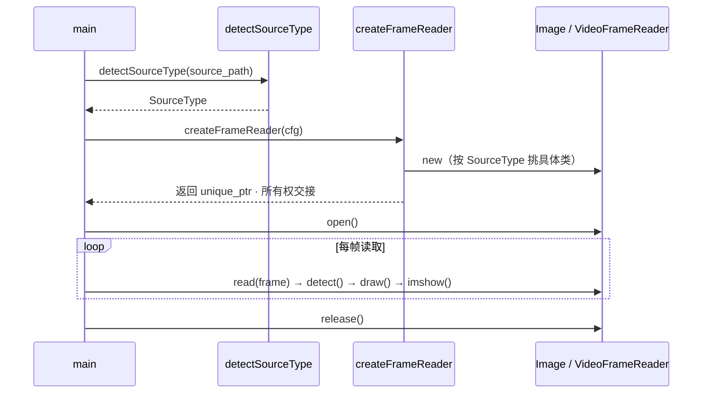
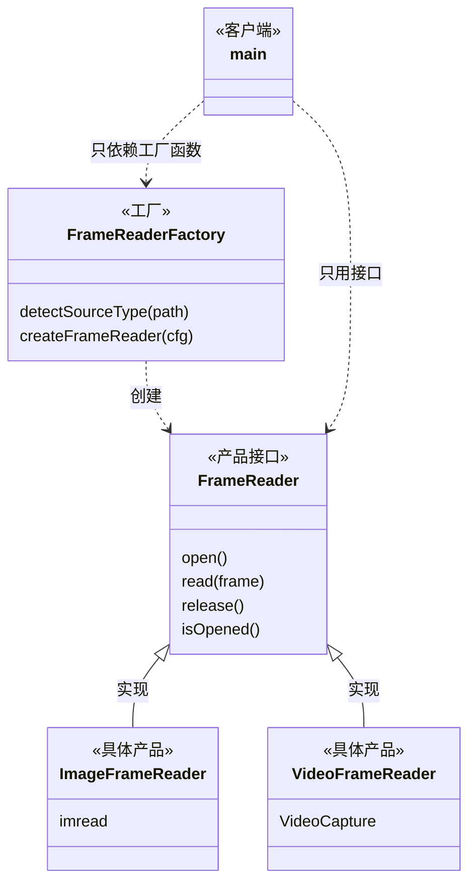

# 设计模式笔记 · 工厂模式（Factory Pattern）

> 配套项目：PedestrianDetectionSystem **v0.2.0** · **v0.2.1 打磨中**
>
> 相关文档：[README.md](../README.md)（项目说明）· [opencv-notes.md](opencv-notes.md)（OpenCV 知识点）· [cpp-oop-notes.md](cpp-oop-notes.md)（接口 / 多态 / RAII）
>
> 本文用项目里 `FrameReaderFactory` 这个真实例子讲清工厂模式：**为什么需要它 → 它长什么样 → 怎么扩展 → 有什么坑**。
> 文中行号对应本仓库当前源码，随版本迭代同步更新。

## 目录

- [设计模式笔记 · 工厂模式（Factory Pattern）](#设计模式笔记--工厂模式factory-pattern)
  - [目录](#目录)
  - [§1 问题：运行时才知道要创建谁](#1-问题运行时才知道要创建谁)
  - [§2 本项目怎么写的（代码走读）](#2-本项目怎么写的代码走读)
    - [2.1 产品接口](#21-产品接口)
    - [2.2 工厂：两步走](#22-工厂两步走)
    - [2.3 完整调用时序](#23-完整调用时序)
  - [§3 模式结构：产品 / 具体产品 / 工厂](#3-模式结构产品--具体产品--工厂)
  - [§4 工厂的三种常见形态（别搞混）](#4-工厂的三种常见形态别搞混)
  - [§5 两个值得咀嚼的设计决策](#5-两个值得咀嚼的设计决策)
    - [5.1 为什么返回 `unique_ptr` 而不是裸指针](#51-为什么返回-unique_ptr-而不是裸指针)
    - [5.2 为什么工厂只"创建"不"打开"](#52-为什么工厂只创建不打开)
  - [§6 扩展指南：怎么加一种新输入源](#6-扩展指南怎么加一种新输入源)
    - [6.1 直接改工厂（本项目的做法）](#61-直接改工厂本项目的做法)
    - [6.2 进阶：注册表 + 自注册（开闭原则）](#62-进阶注册表--自注册开闭原则)
  - [§7 常见坑](#7-常见坑)
  - [§8 与其他模式 / 概念的关系](#8-与其他模式--概念的关系)
  - [§9 什么时候**不该**用工厂](#9-什么时候不该用工厂)
  - [§10 练习与自测题](#10-练习与自测题)
    - [练习](#练习)
    - [自测题](#自测题)
  - [更新记录](#更新记录)

---

## §1 问题：运行时才知道要创建谁

v0.1 的程序只会读图片，`main` 里写死一句 `cv::imread` 就够了。v0.2 要同时支持图片和视频，问题立刻变成：

> 用户在命令行给的是一串路径，**程序运行时**才知道它是图片还是视频 —— 我该创建哪个对象？

最直白的写法是在 `main` 里分支：

```cpp
// ❌ 能跑，但很糟糕的写法
if (isImagePath(path)) {
    // 读图片、检测、画框、显示、退出…… 一整套流程
} else if (isVideoPath(path)) {
    // 打开视频、循环读帧、检测、画框、显示、处理按键…… 又一套流程
}
```

这种写法的问题不是"跑不起来"，而是：

1. **调用方被迫知道所有具体类型**。`main` 得认识 `ImageFrameReader`、`VideoFrameReader`，将来还有摄像头、RTSP、图片文件夹……每加一种，`main` 就长一截。
2. **判断逻辑散落**。扩展名怎么判、大小写怎么处理、要不要支持无扩展名 —— 这些知识会渗进业务代码里。
3. **两套流程 90% 是重复的**（检测、画框、显示、按键），却因为"创建方式不同"被迫复制。

工厂模式要解决的问题就一句话：

> **把"创建哪个具体对象"这个决定，从使用对象的地方收拢到一个专门的函数里，并让调用方只面向抽象接口编程。**

于是 `main` 变成了这样（`src/main.cpp:39-71`，已经看不到任何具体 Reader 的名字）：

```cpp
std::unique_ptr<FrameReader> fr = createFrameReader(cfg);   // 工厂：给我一个能读帧的东西
if (!fr->open()) { /* ... */ }
while (fr->read(frame)) {          // 之后只和抽象打交道
    const auto d = pd->detect(frame);
    drawDetections(frame, d);
    cv::imshow(kWindowName, frame);
    if (cv::waitKey(delay) == 27) break;
}
```

**图片和视频的差别被压缩进了工厂内部，`main` 只剩一条数据流。**

---

## §2 本项目怎么写的（代码走读）

涉及三个文件：

| 文件                                                         | 角色                     |
| ------------------------------------------------------------ | ------------------------ |
| `include/FrameReader.hpp`                                    | **产品接口**（抽象基类） |
| `include/ImageFrameReader.hpp` / `VideoFrameReader.hpp`      | **具体产品**             |
| `include/FrameReaderFactory.hpp` + `src/FrameReaderFactory.cpp` | **工厂**（两个自由函数） |

### 2.1 产品接口

```cpp
// include/FrameReader.hpp:8-19
class FrameReader {
public:
    virtual bool open() = 0;
    virtual bool read(cv::Mat &frame) = 0;
    virtual void release() = 0;
    virtual bool isOpened() const = 0;
    virtual ~FrameReader() = default;   // ⚠️ 必须虚析构，见 §7
};
```

注意：**接口里没有任何数据成员，也完全没提 OpenCV 之外的实现细节**。工厂返回的正是这个类型 —— 调用方拿到的能力上限，就是这四个方法。

### 2.2 工厂：两步走

```cpp
// include/FrameReaderFactory.hpp:7-15
enum class SourceType { Image, Video, Unknown };

SourceType detectSourceType(const std::string &path);              // 第 1 步：判类型
std::unique_ptr<FrameReader> createFrameReader(const ProjConfig &cfg);  // 第 2 步：造对象
```

`detectSourceType` 的实现策略是**按扩展名分派**（`src/FrameReaderFactory.cpp:26-53`）：

```cpp
const std::string extension = convertExtensionToLower(path);   // 先归一化成小写
if (extension.empty()) return SourceType::Unknown;             // 没有扩展名 → 认不出

static const std::string kImageExtensions[] = {"jpg", "jpeg", "png", "bmp", "tif", "tiff", "webp", "ppm", "pgm"};
for (const std::string &kie : kImageExtensions) if (kie == extension) return SourceType::Image;

static const char *kVideoExtensions[] = {"mp4", "avi", "mov", "mkv", "flv", "wmv", "webm", "m4v"};
for (const std::string &kve : kVideoExtensions) if (kve == extension) return SourceType::Video;

return SourceType::Unknown;
```

`createFrameReader` 就是一个 `switch`（`src/FrameReaderFactory.cpp:56-66`）：

```cpp
std::unique_ptr<FrameReader> createFrameReader(const ProjConfig &cfg) {
    switch (detectSourceType(cfg.source_path)) {
        case SourceType::Image: return std::make_unique<ImageFrameReader>(cfg);
        case SourceType::Video: return std::make_unique<VideoFrameReader>(cfg);
        case SourceType::Unknown:
        default: throw std::invalid_argument("无法识别的源类型：" + cfg.source_path);
    }
}
```

**三个值得注意的点：**

1. **工厂把 `SourceType` 判定的结果"翻译"成了具体类**。判定逻辑（扩展名表）和创建逻辑（`switch`）都在工厂内部，外部完全看不见。
2. **调用方拿到的静态类型是 `FrameReader`（基类），动态类型是 `ImageFrameReader` / `VideoFrameReader`（派生类）** —— 这正是多态登场的地方，机制细节见 [cpp-oop-notes.md](cpp-oop-notes.md)。
3. **失败用抛异常表达**（`SourceType::Unknown` 时 `throw std::invalid_argument`），由 `main.cpp:40-45` 的 `try/catch` 接住。注意 `main.cpp:33-37` 还提前判了一次 `Unknown` 并打印友好提示 —— 属于**双保险**：因为工厂是通用组件，它不能假设所有调用方都会先替它做检查。

### 2.3 完整调用时序



---

## §3 模式结构：产品 / 具体产品 / 工厂



模式的四个角色在本项目里的对应：

| 角色                        | 本项目                                 | 说明                      |
| --------------------------- | -------------------------------------- | ------------------------- |
| Product（抽象产品）         | `FrameReader`                          | 定义产品能力              |
| ConcreteProduct（具体产品） | `ImageFrameReader`、`VideoFrameReader` | 各自实现                  |
| Factory（工厂）             | `createFrameReader()`                  | 唯一知道"该造谁"的地方    |
| Client（客户端）            | `main()`                               | 只面向 `FrameReader` 编程 |

---

## §4 工厂的三种常见形态（别搞混）

面试和实际代码里，"工厂"一词经常指三个不同的东西：

| 形态                                                         | 本项目   | 创建方式                                         | 典型特征                                        | 何时用                                              |
| ------------------------------------------------------------ | -------- | ------------------------------------------------ | ----------------------------------------------- | --------------------------------------------------- |
| **简单工厂 / 静态工厂函数**<br>（Simple Factory，非 GoF 23 种之一） | ✅ 就是它 | 一个（静态）函数内部 `switch`                    | 集中一处 `if/else`，客户端零分支                | 产品种类有限、变化不频繁 —— **绝大多数场景够用**    |
| **工厂方法**<br>（Factory Method，GoF）                      | ✗        | 把创建动作做成**虚函数**，每个工厂子类造一种产品 | 继承自 `Factory` 基类，`factory->create()` 多态 | 创建逻辑本身也要多态 / 想避免改工厂本体（开闭原则） |
| **抽象工厂**<br>（Abstract Factory，GoF）                    | ✗        | 一个工厂接口产出**一族**相关产品                 | 如 `WinFactory` 同时产 `Button`+`Scrollbar`     | 产品成族出现、必须配套使用（换皮肤、换后端）        |

**本项目选简单工厂是合适的**：产品就两种、判定规则一目了然、没有"工厂本身也要扩展"的需求。

把简单工厂硬改成工厂方法，会多出 `ImageFrameReaderFactory` / `VideoFrameReaderFactory` 两个类，收益为零 —— **不要为了用模式而用模式**。

> 一个便利贴式的判断法：变化点在**"造哪个"** → 简单工厂；变化点在**"怎么造"** → 工厂方法；变化点是**"哪一族"** → 抽象工厂。

---

## §5 两个值得咀嚼的设计决策

### 5.1 为什么返回 `unique_ptr` 而不是裸指针

```cpp
std::unique_ptr<FrameReader> createFrameReader(const ProjConfig &cfg);
```

如果返回裸指针 `FrameReader*`，调用方就必须回答"**谁负责 delete**"这个问题 —— 而这个问题没有写在签名里，只能靠文档或口口相传。一旦调用方忘了 delete，或者中途 `return`/抛异常，就是泄漏。

`unique_ptr` 把答案写进了类型里：

- **所有权明确转移**给调用方（函数返回即交接）；
- 调用方不需要 `delete`，离开作用域自动析构；
- 编译器保证"所有正常路径上只有一个所有者"，无法被复制带走。

更进一步：因为 `FrameReader` 有虚析构函数，`unique_ptr<FrameReader>` 析构时会正确调用**派生类**的析构函数（`~VideoFrameReader` → 释放 `cv::VideoCapture` 句柄）。**如果析构函数不是虚的，这就是未定义行为** —— 详见 [cpp-oop-notes.md](cpp-oop-notes.md) §4。

### 5.2 为什么工厂只"创建"不"打开"

对比这两种接口设计：

```cpp
// A. 本项目：两阶段 —— 先创建，再显式打开
fr = createFrameReader(cfg);
if (!fr->open()) { /* 处理失败 */ }

// B. 另一种做法：一步到位，构造即打开，失败抛异常
fr = createFrameReader(cfg);   // 内部完成 open，失败则 throw
```

看起来 B 更简洁，本项目却选了 A，原因：

1. **"创建"和"打开"是两种不同性质的失败**。创建失败 = 路径类型不认识（**编程/输入错误**）；打开失败 = 文件不存在、没有解码器、摄像头被占用（**运行时环境问题**）。分开之后，`main` 能给出**不同的错误提示**（`main.cpp:34-37` vs `main.cpp:47-50`），排查问题时信息量完全不同。
2. **构造函数的失败只能靠异常**。而 `open()` 可以返回 `bool`，调用方想用返回值处理就用返回值，想忽略也编译得过 —— 对 `main` 这种"顶层调度"代码，返回码更轻。
3. **工厂不需要知道具体产品的构造参数**。`ImageFrameReader(cfg)` 和 `VideoFrameReader(cfg)` 都只吃一个 `ProjConfig`，工厂只负责 `new`；"怎么打开"是产品自己的事（`ImageFrameReader::open` 只检查路径非空，`VideoFrameReader::open` 还要真的去 `cap_.open()`）。

**代价也很真实**：对象有了"已创建但未打开"的中间状态 —— 接口里那个 `isOpened()` 和实现里那几个 `bool isOpened_` 标志位，正是为它付的账（`FrameReader.hpp:16`、`ImageFrameReader.hpp:23`、`VideoFrameReader.hpp:26`）。调用方如果忘了 `open()` 直接 `read()`，只能拿到一个 `false` 而不是编译错误。

> 这是一次典型的**权衡**，没有标准答案：追求 RAII 纯度会选择 B（构造即完成初始化），追求错误分类与简单工厂会选择 A。本项目选了 A。

---

## §6 扩展指南：怎么加一种新输入源

### 6.1 直接改工厂（本项目的做法）

假设要加**摄像头**，需要动三处：

```cpp
// 1. 新建 include/CameraFrameReader.hpp + src/CameraFrameReader.cpp
class CameraFrameReader final : public FrameReader {
    // 内部持有 cv::VideoCapture cap_;  open() 时 cap_.open(0);
};

// 2. src/FrameReaderFactory.cpp：让它能被识别
//    SourceType 枚举加 Camera；
//    detectSourceType 里识别 "cam:0" / "0" 这类前缀或纯数字

// 3. src/FrameReaderFactory.cpp:57 的 switch 里加一个 case
case SourceType::Camera: return std::make_unique<CameraFrameReader>(cfg);
```

**这就是简单工厂的固有代价：每加一种产品，都要回来修改工厂本体。**

以"开闭原则（OCP：对扩展开放、对修改关闭）"的标准衡量，当前设计是**不满足**的 —— 好消息是"修改"被限制在了一个函数内，坏消息是这个函数会随着产品种类增长而变胖，而且 `detectSourceType` 一旦复杂到需要（比如）探测文件头，判定逻辑会迅速膨胀。

反过来看，`main`、`PedestrianDetector`、绘图代码**一行都不用改** —— 变化被隔离在工厂内部，这才是模式真正买到的稳定性。

### 6.2 进阶：注册表 + 自注册（开闭原则）

要让"新增产品不改工厂"，可以把 `switch` 换成**注册表**：

```cpp
// 概念示例：注册表版工厂
using Creator = std::function<std::unique_ptr<FrameReader>(const ProjConfig &)>;

class ReaderRegistry {
public:
    static ReaderRegistry &instance() { static ReaderRegistry r; return r; }

    void add(SourceType type, Creator c) { map_[type] = std::move(c); }

    std::unique_ptr<FrameReader> create(const ProjConfig &cfg) const {
        const SourceType t = detectSourceType(cfg.source_path);
        const auto it = map_.find(t);
        if (it == map_.end()) throw std::invalid_argument("未注册的源类型");
        return it->second(cfg);          // 调用注册时存入的 lambda
    }
private:
    std::unordered_map<SourceType, Creator> map_;
};

// 每个 Reader 的 .cpp 文件末尾"自注册"：
// static const bool registered = [] {
//     ReaderRegistry::instance().add(SourceType::Camera,
//         [](const ProjConfig &c) { return std::make_unique<CameraFrameReader>(c); });
//     return true;
// }();
```

这样新增一种源 = **只新增一个 .cpp**，工厂和 `main` 都不用碰。代价是：控制流不再一眼看穿（要跳去各个文件的静态初始化找注册点）、静态初始化顺序有讲究、调试时略绕。

> **工程判断**：产品 ≤ 5 种、团队规模不大时，`switch` 的可读性收益 > OCP 的形式收益。注册表是"知道它在哪、什么时候用"的储备知识，不必急着上。

---

## §7 常见坑

1. **忘了虚析构函数** —— 最致命的一个。`unique_ptr<FrameReader>` 析构时若基类没有虚析构，只会调用 `~FrameReader`，派生类的成员（比如 `cv::VideoCapture`）不会被析构，是**未定义行为**。本项目写了 `virtual ~FrameReader() = default;`（`FrameReader.hpp:18`），正确。
2. **工厂返回裸指针** —— 所有权靠猜。永远返回 `unique_ptr`（或 `shared_ptr`，如果你确实需要共享所有权；本项目不需要）。
3. **在工厂里做重活** —— 工厂应该只回答"造谁"，不要顺手做初始化、打开文件、读配置。本项目把 `open()` 留给调用方，工厂只有 10 行。
4. **判定逻辑写脆弱** —— 本项目是"按扩展名"分派，天然有短板：
	- 无扩展名的文件、`http://x/video.mp4?token=1` 这类带查询串的 URL 会判错（`find_last_of('.')` 会截到 `mp4?token=1`）；
	- 扩展名说谎（`.jpg` 里装着别的格式）无法识别；
	- 大小写已处理（`convertExtensionToLower`），这是容易漏的一步。
		更稳的做法：**按内容嗅探**（读文件头 magic number）或干脆"先按视频打开试试，失败再按图片"。
5. **异常 vs 返回 nullptr 不统一** —— 本项目 `Unknown` 时抛 `std::invalid_argument`，调用方必须 `try/catch`；如果改成返回 `nullptr`，调用方就必须判空。**两种都行，但不能混**：现在 `main` 里既有 `try/catch`（`main.cpp:40-45`）又有对 `open()` 返回值的检查，风格是自洽的。
6. **工厂的返回值被"切片"** —— 只要经手的是 `FrameReader`（指针/引用），多态就成立；一旦写成 `FrameReader fr = *ptr;`（值拷贝），派生部分会被切掉。用 `unique_ptr` 天然避免。
7. **`SourceType` 判定执行了两次** —— `main.cpp:33` 调一次，`createFrameReader` 内部（`FrameReaderFactory.cpp:57`）又调一次。当前实现是纯字符串比较，代价可忽略；如果将来变成"嗅探文件头"，就该把结果传进去而不是重复计算。属于"知道就好"的小账。

---

## §8 与其他模式 / 概念的关系

| 概念                           | 关系                                                         |
| ------------------------------ | ------------------------------------------------------------ |
| **多态 / 虚函数**              | 工厂的搭档：工厂负责"造出基类指针"，多态负责"之后按派生类行为运行"。见 [cpp-oop-notes.md](cpp-oop-notes.md) |
| **RAII / 智能指针**            | `unique_ptr` 是工厂安全的另一半：明确了所有权，异常路径也不泄漏 |
| **依赖倒置（DIP）**            | `main` 依赖 `FrameReader` 抽象而非具体类 —— 工厂是落地 DIP 的常用手段 |
| **策略模式（Strategy）**       | 结构上与工厂 + 多态几乎同构，区别在**意图**：策略是"运行时换算法"，工厂是"运行时换创建"。本项目的 `FrameReader` 恰好两者都沾：既是产品，也可以看作"读帧策略" |
| **建造者（Builder）/ DI 容器** | 当对象构造需要一堆参数和步骤时，用 Builder 或依赖注入容器替代工厂 |

---

## §9 什么时候**不该**用工厂

- **只有一种产品、且短期内不会增加** —— 直接构造，少一层间接。
- **调用方本来就知道确切类型** —— 没有"运行时才知道"的问题，工厂只是徒增间接。
- **创建逻辑简单到只有一行 `new`** —— 工厂的收益是"隔离变化"，没有变化就没有收益。
- **团队里没人看得懂** —— 模式的成本是认知负担；一个 `switch` 能被所有人一眼看懂时，它比注册表更"工程"。

本项目当前只有两种输入源，工厂的价值已经开始显现（`main` 一条数据流跑通图片和视频），**规模恰好卡在"值得用"的边界上** —— 这个判断本身，比模式本身更值得学习。

---

## §10 练习与自测题

### 练习

1. **加一种源**：按 §6.1 的步骤实现 `CameraFrameReader`（`cv::VideoCapture cap_; cap_.open(0);`），让 `detectSourceType` 识别 `cam` 前缀。做完之后，数一数你一共改了几个文件、`main` 改了没有。
2. **反向验证**：临时把 `createFrameReader` 改成返回裸指针版本，在 `main` 里手动 `delete`，然后制造一个中途 `return` 的分支，观察泄漏（可配合 `valgrind --leak-check=full`）。体会 `unique_ptr` 替你挡掉了什么。
3. **读 §9.12 相关的代码**：`ImageFrameReader::read` 在 `imread` 失败时仍返回 `true`。分别从"工厂的责任"和"产品的责任"两个角度，判断这个 bug 该由谁修、为什么。
4. **进阶**：把 `switch` 改写成 §6.2 的注册表版本，新增一种源时验证"零改动工厂"。然后写三句话说服/反驳"这个改动值得"。
5. **讨论**：如果把 `detectSourceType` 从"看扩展名"改成"读文件头"，`main` 和工厂的接口需要变吗？（提示：想想第 §7 条"判定执行了两次"的账。）

### 自测题

- 工厂模式解决的**核心问题**是什么？用一句话说清。
- 简单工厂、工厂方法、抽象工厂的区别？本项目属于哪种？
- 为什么工厂要返回 `unique_ptr` 而不是裸指针？这对调用方意味着什么？
- 工厂返回的静态类型和动态类型分别是什么？为什么这样设计能"对扩展开放"？
- 本项目为什么把 `open()` 从构造函数里拿出来？这个设计的代价是什么？
- 新增一种输入源需要改哪些文件？为什么说这违反了开闭原则？注册表版如何解决？
- 如果 `FrameReader` 忘了写 `virtual ~FrameReader()`，会发生什么？为什么？
- 举两个**不该**使用工厂模式的场景。

---

## 更新记录

- **v0.2.1**（预告，代码未落地）：`FrameReader` 将新增**带默认实现的虚函数** `virtual int frameDelayMs() const` 等，把"播放节奏"也收进抽象（见 [README](../README.md#v021-计划)）。落地后需同步：§2.1 的接口清单、§2.2 的类图、§5.2「为什么工厂只创建不打开」的讨论。
- **v0.2.0**：初版。基于 `FrameReaderFactory` / `FrameReader` / 两个 Reader 实现的真实代码整理。

*本笔记是「模块知识笔记」系列的一篇，与 [opencv-notes.md](opencv-notes.md)、[cpp-oop-notes.md](cpp-oop-notes.md) 并列；项目里引入新的设计模式时，按同样格式另开一篇。*