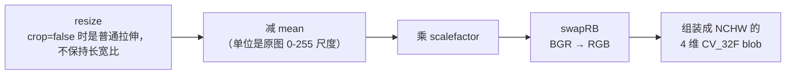
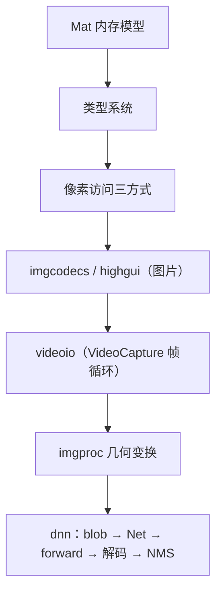

# PedestrianDetectionSystem · OpenCV 学习笔记

> 配套项目：PedestrianDetectionSystem **v0.2.0**（图片 + 视频 · 单类别 person · YOLOv8n ONNX + OpenCV DNN）· **v0.2.1 打磨中**
> 相关文档：[README.md](../README.md)（项目说明）· [factory-pattern.md](factory-pattern.md)（工厂模式）· [cpp-oop-notes.md](cpp-oop-notes.md)（接口 / 多态 / RAII）
> 适用：OpenCV 4.x / 5.x —— 本项目实际编译链接的是自编译的 **OpenCV 5.1.0**（`/usr/local`），用到的 API 两个大版本一致。
> 文中行号对应本仓库当前源码（`src/`、`include/`、`scripts/`），随版本迭代同步更新。
>
> 本文件**只写 OpenCV 相关内容**。设计模式、C++ 语言特性等非 OpenCV 知识点见上面链接的两篇独立笔记。
>
> 阅读建议：先看 §0 建立地图 → 按 §1~§10 顺序学习 → 用 §11 的练习和自测题巩固。

## 目录

- [PedestrianDetectionSystem · OpenCV 学习笔记](#pedestriandetectionsystem--opencv-学习笔记)
  - [目录](#目录)
  - [§0 总览：项目代码 ↔ OpenCV 知识点](#0-总览项目代码--opencv-知识点)
  - [§1 cv::Mat：整个 OpenCV 的地基](#1-cvmat整个-opencv-的地基)
    - [1.1 本质：矩阵头 + 数据块 + 引用计数](#11-本质矩阵头--数据块--引用计数)
    - [1.2 Mat 的构造方式](#12-mat-的构造方式)
    - [1.3 类型系统：`CV_<depth>C<channels>`](#13-类型系统cv_depthcchannels)
    - [1.4 维度与 shape：`Size(w,h)` vs `Mat(rows,cols)` 的大坑](#14-维度与-shapesizewh-vs-matrowscols-的大坑)
    - [1.5 连续性、step、data 指针](#15-连续性stepdata-指针)
    - [1.6 视图 vs 新分配](#16-视图-vs-新分配)
  - [§2 图像 / 视频 I/O 与 HighGUI](#2-图像--视频-io-与-highgui)
    - [2.1 图片：`imread` / `imwrite`](#21-图片imread--imwrite)
    - [2.2 视频：`cv::VideoCapture`（v0.2 新增）](#22-视频cvvideocapturev02-新增)
    - [2.3 HighGUI：显示与帧循环的节奏](#23-highgui显示与帧循环的节奏)
  - [§3 几何变换：resize 与 LetterBox](#3-几何变换resize-与-letterbox)
    - [3.1 `cv::resize` 签名与语义（`PedestrianDetector.cpp:36`）](#31-cvresize-签名与语义pedestriandetectorcpp36)
    - [3.2 LetterBox 的数学（本项目核心算法，值得吃透）](#32-letterbox-的数学本项目核心算法值得吃透)
  - [§4 `cv::dnn::blobFromImage`：预处理全家桶](#4-cvdnnblobfromimage预处理全家桶)
  - [§5 DNN 模块](#5-dnn-模块)
    - [`cv::dnn::NMSBoxes`（`PedestrianDetector.cpp:89`）](#cvdnnnmsboxespedestriandetectorcpp89)
  - [§6 后处理里的 core 操作](#6-后处理里的-core-操作)
  - [§7 绘图 API](#7-绘图-api)
  - [§8 基础类型速查](#8-基础类型速查)
  - [§9 本项目中的易错点（自查清单）](#9-本项目中的易错点自查清单)
  - [§10 学习路线](#10-学习路线)
  - [§11 练习与自测题](#11-练习与自测题)
    - [练习（基于本项目改代码，从易到难）](#练习基于本项目改代码从易到难)
    - [自测题（能全答上说明基础过关）](#自测题能全答上说明基础过关)
  - [更新记录](#更新记录)

---

## §0 总览：项目代码 ↔ OpenCV 知识点

这个项目虽然只有 400 行左右，但恰好覆盖了 OpenCV 的五条主干：
`core`（Mat 内存模型）、`imgproc`（几何变换、绘图）、`highgui`（显示）、`imgcodecs`（图片读写）、`videoio`（视频解码，v0.2 新增）、`dnn`（推理）。

| 项目位置 | OpenCV API | 所属模块 / 知识主题 |
|---|---|---|
| `src/main.cpp:16-17` | `cv::rectangle` `cv::putText` `cv::Scalar` | imgproc 绘图：颜色序、坐标语义 |
| `src/main.cpp:63` | `FrameReader::read(cv::Mat&)`（多态调用） | 设计模式 → [cpp-oop-notes.md](cpp-oop-notes.md) |
| `src/main.cpp:66` | `cv::imshow` | highgui：显示 |
| `src/main.cpp:67-70` | `cv::waitKey(delay)` + ESC 退出 | highgui：事件泵与节奏控制 |
| `src/main.cpp:74` | `cv::destroyAllWindows` | highgui：收尾 |
| `src/ImageFrameReader.cpp:22` | `cv::imread`（**未检查空图，见 §9.12**） | imgcodecs：读取、失败语义 |
| `src/VideoFrameReader.cpp:14` | `cap.open(video_path_)` | videoio：打开文件 / 流 |
| `src/VideoFrameReader.cpp:27` | `cap.read(frame)` | videoio：逐帧解码与 EOF 语义 |
| `src/VideoFrameReader.cpp:32-33` | `cap.isOpened()` / `cap.release()` | videoio：状态查询与释放 |
| `include/VideoFrameReader.hpp:22` | `cv::VideoCapture` 成员 | videoio：RAII 资源 |
| `include/PedestrianDetector.hpp:5-6` | `opencv2/opencv.hpp` `opencv2/dnn.hpp` | 头文件组织 |
| `include/PedestrianDetector.hpp:12-23` | `cv::Rect` / `cv::Size` | core 基础类型 |
| `src/PedestrianDetector.cpp:9` | `cv::dnn::readNetFromONNX` | dnn：模型加载 |
| `src/PedestrianDetector.cpp:12-14` | `setPreferableBackend/Target`（已注释，默认值生效） | dnn：后端与设备 |
| `src/PedestrianDetector.cpp:19-21` | `cv::Mat::empty()` + 抛异常 | core：空矩阵判断与错误处理 |
| `src/PedestrianDetector.cpp:24-32` | 手工计算 scale/pad（尺寸取自 `ProjConfig`） | 几何变换的数学 |
| `src/PedestrianDetector.cpp:36` | `cv::resize` | imgproc：重采样与插值 |
| `src/PedestrianDetector.cpp:39` | `cv::Mat(rows, cols, type, Scalar)` | core：Mat 构造与填充 |
| `src/PedestrianDetector.cpp:40-41` | `mat(Rect)` + `copyTo` | core：ROI 视图与深拷贝 |
| `src/PedestrianDetector.cpp:50-51` | `reshape` + `transpose` | core：形状操作（视图 vs 新分配） |
| `src/PedestrianDetector.cpp:53,61` | `data` 裸指针 + 包裹外部内存的 Mat 头 | core：内存模型 |
| `src/PedestrianDetector.cpp:64` | `cv::minMaxLoc` | core：矩阵统计 |
| `src/PedestrianDetector.cpp:89` | `cv::dnn::NMSBoxes` | dnn：后处理 |
| `src/PedestrianDetector.cpp:108-116` | `cv::dnn::blobFromImage` | dnn：预处理 |
| `src/PedestrianDetector.cpp:119-120` | `setInput` / `forward` | dnn：前向推理 |

---

## §1 cv::Mat：整个 OpenCV 的地基

### 1.1 本质：矩阵头 + 数据块 + 引用计数

`cv::Mat` 变量 = 一个**矩阵头**（`rows, cols, type, step, data 指针, 引用计数`）+ 它指向的**像素数据块**。拷贝 `Mat` 变量只拷贝头、共享数据：

```cpp
cv::Mat b = a;         // 浅拷贝：b 和 a 指向同一块像素，改 b 影响 a！
cv::Mat c = a.clone(); // 深拷贝：一定新分配
a.copyTo(d);           // 深拷贝（d 尺寸类型不符时才重新分配）
```

**本项目正是靠这个机制工作的**（`PedestrianDetector.cpp:40-41`）：

```cpp
cv::Mat roi = letterbox_img(cv::Rect(lb_info.pad_w, lb_info.pad_h, new_w, new_h));
resized.copyTo(roi);
```

第一行取出的 `roi` 是**共享内存的 ROI 视图**（不是拷贝！），第二行的 `copyTo` 才把像素真正写进画布。

如果写成下面这样就完全错了 —— 那只是让 `roi` 这个头改指向 `resized`，画布纹丝不动：

```cpp
cv::Mat roi = letterbox_img(rect);
roi = resized;   // 错误！这只是"改指向"，不是"把 resized 写进 ROI"
```

> **第一课：赋值 = 改指向，copyTo = 写数据。**

另一个推论：**ROI 视图会拖住整块父内存**（引用计数挂在父 buffer 上）。只要子视图还活着，整张原图就不会被释放。

### 1.2 Mat 的构造方式

| 写法 | 是否分配内存 | 项目中 |
|---|---|---|
| `cv::Mat m;` | 否，空矩阵 | `PedestrianDetector.cpp:35 resized`、`:107 blob`、`:120 output`，作为 API 的输出参数，由 API 内部 `create()` |
| `Mat(rows, cols, type, Scalar)` | 是，且填充 | `PedestrianDetector.cpp:39` 灰底画布 `Mat(input_height, input_width, CV_8UC3, Scalar(114,114,114))` |
| `Mat(rows, cols, type, void* data, step=0)` | **否，只包一个头** | `PedestrianDetector.cpp:61` 的 `scores` —— 把转置矩阵里一段内存"当成" 1×80 的 Mat 用，零拷贝 |
| `cv::Mat frame;`（循环外声明，循环内复用） | 复用已有缓冲 | `src/main.cpp:61` —— 每帧 `read(frame)` 时由 `VideoCapture` 写入，避免反复分配 |

延伸要会：`Mat::zeros/ones`、`Mat(Size(w,h), type)`（注意 Size 是**先宽后高**，与 `Mat(rows, cols)` 正好相反，经典坑）。

**空矩阵判断**：`m.empty()` 等价于 `m.data == nullptr || m.total() == 0`。**`imread` 失败时返回空 Mat 而不是抛异常**，所以本项目两处检查它：`PedestrianDetector.cpp:19-21`（`preprocess` 开头，抛 `std::invalid_argument`，由 `main` 的 `try/catch` 兜底）—— 但 `ImageFrameReader::read` 这一层**漏检了**，是 v0.2.0 的一个真实缺陷，详见 §9.12。

### 1.3 类型系统：`CV_<depth>C<channels>`

| 宏 | 含义 | 项目中出现处 |
|---|---|---|
| `CV_8UC3` | 8 位无符号 × 3 通道（彩色图） | `PedestrianDetector.cpp:39` 画布；`imread` / `VideoCapture::read` 的产物 |
| `CV_32FC1` | 32 位浮点 × 1 通道 | `PedestrianDetector.cpp:61` scores |
| `CV_8U` / `CV_32F` | 仅深度（无通道） | 概念上贯穿全流程 |

- 常用查询：`m.type()`（完整类型码）、`m.depth()`（元素深度）、`m.channels()`、`m.elemSize()`。
- **推理链上的类型流转**：`CV_8UC3`（原图 / letterbox 画布）→ `CV_32F, dims=4`（blob，NCHW，**通道被折进维度里，channels()==1**）→ `CV_32F, dims=3`（output）→ `CV_32FC1` 2D（转置后）。
- **图片与视频的类型一致性**：`cv::imread` 和 `cv::VideoCapture::read` 产出的都是 **BGR、CV_8UC3** 的 2D Mat —— 这正是同一套检测代码能同时服务两种输入源的前提。

> ⚠️ blob 不是"3 通道浮点图"，而是 4 维张量、单通道。这点最容易误解。

### 1.4 维度与 shape：`Size(w,h)` vs `Mat(rows,cols)` 的大坑

- 2D Mat：`rows`、`cols`；`size()` 返回 `cv::Size(cols, rows)`，而 `cv::Size` 的字段是 **width, height**。
- **高维 Mat（`dims > 2`）不要依赖 `rows/cols`**（文档语义是 `(-1,-1)`），要用 `dims` 和 `size[i]`。

  本项目 `output` 是 1×84×8400 的三维矩阵，所以 `PedestrianDetector.cpp:50-51` 先 `reshape(1, 84)` 变成 2D，再去 `transpose` 和访问 `rows/cols` —— 这个顺序不是随意的。
- `cv::Size(input_width_, input_height_)` 传的是 (宽, 高)，`image.cols/rows` 也是 (宽, 高) —— 同一个概念两套参数顺序，写反了不报错、只是结果错，务必形成肌肉记忆。

### 1.5 连续性、step、data 指针

- 内存布局：**行优先 + 通道交错**（HWC：BGRBGRBGR…）。
- `step` = 每行字节数，可能大于 `cols × elemSize`（当 Mat 是父矩阵的 ROI 时）。用 `isContinuous()` 判断连续性。
- 连续时才能线性寻址 `data[i*cols + j]` —— `PedestrianDetector.cpp:53` 的 `reinterpret_cast<float*>(output_transposed.data)` 正是依赖"transpose 的结果必然是新分配的连续矩阵"。

**三种像素访问方式**（性能从高到低、安全性从低到高）：

| 方式 | 写法 | 特点 |
|---|---|---|
| 裸指针 | `float* p = (float*)m.data; p[i*84 + j]` | 最快；需自己保证连续 + 类型正确。本项目 `PedestrianDetector.cpp:53` 之后的 `*(data + i*cols + j)` |
| 行指针 | `float* p = m.ptr<float>(i); p[j]` | **推荐**：自动处理 step、类型检查。本项目可改写成这样 |
| 元素访问 | `m.at<float>(i, j)` | 最慢（Debug 带边界检查），调试期用 |

### 1.6 视图 vs 新分配

| 操作 | 拷贝数据？ | 说明 |
|---|---|---|
| `m(Rect)` | 视图 | ROI，共享内存，通常不连续 |
| `m.row(i)` / `m.colRange(a,b)` | 视图 | 行/列切片 |
| `m.reshape(cn, rows)` | 视图 | O(1)，**要求连续**，否则抛异常 |
| `Mat(..., void* data, ...)` | 视图 | 包裹外部内存 |
| `cv::transpose` | **新分配** | 位置重排，必须新内存 |
| `resize` / `copyTo` / `clone` / `blobFromImage` | **新分配** | |
| `VideoCapture::read(frame)` | 复用传入的 frame 缓冲 | `src/main.cpp:61` 的 `frame` 每帧被覆写（内部可能重新分配以适应帧尺寸变化） |

本项目一帧里真正分配内存的只有 4 次（resize、画布、blob、transpose），其余全是视图 —— 这就是所谓的"零拷贝设计"。视频模式下这 4 次分配**每帧发生一次**，是后续性能优化（复用缓冲区）的着力点。

---

## §2 图像 / 视频 I/O 与 HighGUI

### 2.1 图片：`imread` / `imwrite`

| API | 要点 |
|---|---|
| `cv::imread(path, flags)`（`ImageFrameReader.cpp:22`） | 默认 `IMREAD_COLOR`：**3 通道 BGR、CV_8U、丢弃 alpha**；另有 `IMREAD_GRAYSCALE` / `IMREAD_UNCHANGED`。**失败返回空 Mat 不抛异常** —— 必须 `if (img.empty())` 检查 |
| BGR 不是 RGB | OpenCV 的历史约定。`cv::Scalar(0,0,255)` 是**红**（`main.cpp:13`）；转 RGB 用 `cvtColor(BGR2RGB)` 或交给 `blobFromImage(swapRB=true)` |
| （延伸）`cv::imwrite(path, mat)` | 调试神器：把中间 Mat 存盘看效果，比 imshow 更适合无头 / 远程环境，也是 v0.2.2 候选「截图保存」的现成方案 |

### 2.2 视频：`cv::VideoCapture`（v0.2 新增）

本项目 `VideoFrameReader` 对它的用法只有四行（`src/VideoFrameReader.cpp:14,27,32-33`）：

```cpp
cv::VideoCapture cap_;          // 成员：一个视频就对应一个 Capture 对象（include/VideoFrameReader.hpp:22）
cap_.open(video_path_);         // 打开文件；失败返回 false，不抛异常
cap_.read(frame);               // 取下一帧；失败（含读到结尾）返回 false
cap_.release();                 // 释放底层解码器与文件句柄
```

**必须理解的几点：**

1. **参数的多态性**：`open()` 接受字符串或整数。
   - 字符串 → 按**文件路径 / URL** 解析（`"video.mp4"`、`"rtsp://..."`）；
   - 整数 → 按**摄像头索引**解析（`0` 是默认摄像头）。
   - ⚠️ 经典坑：`cap.open("0")`（字符串）会被当成一个叫 "0" 的**文件**，打不开；要用整数 `cap.open(0)`。
2. **`read()` = `grab()` + `retrieve()`**：前者抓取压缩流中的下一帧，后者解码并填充 Mat。单流场景直接 `read`；多路流想先抓齐再解码时，才需要分开调用。
3. **EOF 语义**：读到视频结尾 `read` 返回 `false`。所以 `while (fr->read(frame))`（`main.cpp:63`）能自然收尾，**无需预先知道总帧数** —— 这与 `imread` 的"失败 = 空 Mat"是两套不同的错误表达方式，见 §9.13。
4. **属性读写** `cap.get(propId)` / `cap.set(propId, value)`，常用属性：

   | 属性 | 含义 | 注意事项 |
   |---|---|---|
   | `CAP_PROP_FRAME_WIDTH/HEIGHT` | 帧宽高 | 对摄像头 set 常常不生效，要 get 回来验证 |
   | `CAP_PROP_FPS` | 帧率 | 文件里没有元数据时返回 0，**做除数前必须判零** |
   | `CAP_PROP_FRAME_COUNT` | 总帧数 | 直播流 / 某些容器不可靠，可能为 0 或负数 |
   | `CAP_PROP_POS_FRAMES` / `POS_MSEC` | 当前位置 | 可用 `set` 实现跳转、抽帧（跳帧检测属性能主题，v0.3 及以后） |
   | `CAP_PROP_FOURCC` | 编码格式 | 摄像头设 `'MJPG'` 常能提高分辨率下的帧率 |
   | `CAP_PROP_BUFFERSIZE` | 缓冲帧数 | 实时流降延迟用 |

5. **后端选择**：`cap.open(path, apiPreference)` 可指定 `CAP_FFMPEG`（文件解码，最通用）、`CAP_V4L2`（Linux 摄像头）、`CAP_MSMF`（Windows）；默认 `CAP_ANY` 自动挑。同一个文件换后端可能"能打开"和"打不开"互换 —— 排查解码问题时值得一试。
6. **产物格式**：`read(frame)` 出来的是 **BGR、CV_8UC3** 的普通 Mat，和 `imread` 完全一致，所以 v0.1 写的 `detect()` 一行都不用改就能吃视频帧 —— 这是 `FrameReader` 抽象能成立的技术前提。
7. **`cv::VideoCapture` 自带 RAII**：析构函数会释放句柄，即使忘了 `release()` 也不会泄漏底层资源（但 `isOpened()` 状态会撒谎）。详见 [cpp-oop-notes.md](cpp-oop-notes.md)。

### 2.3 HighGUI：显示与帧循环的节奏

| API | 要点 |
|---|---|
| `cv::imshow(win, mat)`（`main.cpp:66`） | 只接受 8U；**浮点 Mat 会按 [0,1]→[0,255] 映射**（调试 blob 时会看到全黑/全白）；无头环境不可用（需要 X11 / Wayland，SSH 里请改用 `imwrite`） |
| `cv::waitKey(delay)`（`main.cpp:67`） | 双重身份：**等按键 + GUI 事件泵**（不调用窗口就不刷新）。参数为毫秒，返回按键码，无按键返回 -1 |
| `cv::destroyAllWindows()`（`main.cpp:74`） | 关闭全部窗口。程序退出前调用是礼貌，也避免"窗口残留"的错觉 |

**`delay` 怎么选？本项目给了标准答案**（`main.cpp:62`）：

```cpp
const int delay = (type == SourceType::Image) ? 0 : 1;
```

| 场景 | 传值 | 行为 |
|---|---|---|
| 单张图片 | `0` | **无限等待按键**，窗口停住直到用户按 ESC；下一轮循环 `ImageFrameReader::read` 返回 false，程序退出 |
| 视频 | `1` | 至少等 1ms 后继续 —— 视频是"尽快解码"，`1` 的作用是**让 GUI 事件泵有机会处理按键与重绘**，而不是控制播放速度 |

> ⚠️ 两个高频错误：
> 1. 视频循环里写成 `waitKey(0)` → 程序**卡死在第一帧**，看起来像"卡住了"。
> 2. 不调用 `waitKey` → 窗口不刷新、按键收不到，程序像在空转。

**想按原视频帧率播放**，需要自己换算（**v0.2.1 待办**，届时会封装成 `FrameReader::frameDelayMs()`）：

```cpp
const double fps = cap.get(cv::CAP_PROP_FPS);
const int delay = (fps > 0) ? static_cast<int>(1000.0 / fps + 0.5) : 30;  // 判零！
```

**退出键**：本项目用 `key == 27`（ESC 的 ASCII 码，`main.cpp:68`）跳出循环。`waitKey` 返回的是该键的 ASCII 值，所以 `'q'` 就是 `'q'`，两种写法都常见。

---

## §3 几何变换：resize 与 LetterBox

### 3.1 `cv::resize` 签名与语义（`PedestrianDetector.cpp:36`）

```cpp
cv::resize(src, dst, dsize, fx, fy, interpolation);
// dsize 非空时以 dsize 为准；dsize=Size() 时才用 fx/fy
```

插值方式选择：

| 插值 | 何时用 |
|---|---|
| `INTER_LINEAR` | 默认（本项目省略了该参数，走的就是它），放大 / 通用 |
| `INTER_AREA` | **缩小首选**（避免混叠 / 摩尔纹）—— 本项目是缩小却用了 LINEAR，可作为实验点 |
| `INTER_NEAREST` | 最快最糙（标签图） |
| `INTER_CUBIC` / `INTER_LANCZOS4` | 更平滑但更慢 |

**目标尺寸的防御**：`new_w/new_h` 被钳到至少 1（`PedestrianDetector.cpp:29-30`）。极端长宽比的图（如 2000×10）等比缩到 640 宽后，高度 `round` 可能算成 0，而 `resize` 的目标尺寸出现 0 会直接抛异常 —— 钳位是最低成本的保护（见 §11 练习 3）。

### 3.2 LetterBox 的数学（本项目核心算法，值得吃透）

- 三个量：`scale = min(640/W, 640/H)`、`new_w/new_h`、`pad_w/pad_h`（`PedestrianDetector.cpp:24-32`）。
- **正变换**（原图 → 网络输入）：`x' = x·scale + pad_w`，`y' = y·scale + pad_h`
- **逆变换**（网络输出 → 原图，`PedestrianDetector.cpp:74-77`）：`x = (x' - pad_w)/scale`
- 灰边 114 是 YOLO 系列的训练惯例（`PedestrianDetector.cpp:39`），推理必须与训练一致。
- 误差来源意识：整数除法导致左右 pad 差 1px；`round` 引入 ±0.5px —— **像素域的几何变换永远有舍入误差**。
- v0.2.0 起 `640` 不再硬编码：来自 `ProjConfig::input_width/input_height`（默认 640×640）。**但 `scripts/export_onnx.py` 里的 `imgsz=640` 仍是独立的一份**，两处必须一致且依然没有机制保证（见 §9.2）。
- 视频场景下这套变换**每帧执行一次**：`scale/pad` 只与分辨率有关，同一个视频的所有帧分辨率相同 —— 理论上可以算一次缓存起来，是一个自然的优化点（v0.3 及以后，性能主题）。

延伸实现方式（进阶对比学习）：

- `cv::copyMakeBorder` 替代手工建画布；
- `getAffineTransform` + `warpAffine` 把"缩放 + 平移"打包成 2×3 仿射矩阵一次完成，逆变换还有现成的 `cv::invertAffineTransform`。

---

## §4 `cv::dnn::blobFromImage`：预处理全家桶

本项目调用（`PedestrianDetector.cpp:108-116`）：

```cpp
cv::dnn::blobFromImage(
    input_blob,      // 注意：变量名叫 blob，其实是 letterbox 后的 CV_8UC3 图像，不是 blob！
    blob,            // 输出：CV_32F、NCHW、1×3×640×640
    1.0 / 255,       // scalefactor
    cv::Size(),      // 不缩放（图像已经是目标尺寸）
    cv::Scalar(0,0,0), // mean
    true,            // swapRB：BGR → RGB
    false            // crop
);
```

一次完成 5 件事，执行顺序：



必须理解的三个点：

1. **它不保持长宽比**。所以本项目要先手工 letterbox，再让 `blobFromImage` 做一次"尺寸恰好也是目标尺寸"的空 resize（`cv::Size()` 传空即不缩放）。这也解释了为什么 `ProjConfig::input_width/input_height` 与 letterbox 画布的尺寸、ONNX 导出时的 `imgsz` **三处必须一致**，否则 `LetterBoxInfo` 描述的坐标系与实际输入错配，**且不会报错**，只是框全歪。
2. **归一化公式 `(px - mean) × scalefactor`**：本项目 `mean=0, scale=1/255` → [0,1]。若模型训练时用了 ImageNet 均值，这里要写 `mean=Scalar(0.485*255, ...)`（**0-255 尺度**！高频坑）；若还有 per-channel std，单个 `scalefactor` 表达不了，需手工分通道 `convertTo`。
3. **手工等价实现**（帮助理解）：`resize` → `convertTo(CV_32F, 1/255)` → swapRB → `reshape` 成 NCHW。`blobFromImage` 只是这些操作的封装。

---

## §5 DNN 模块

| API | 要点 |
|---|---|
| `cv::dnn::readNetFromONNX(path)`（`PedestrianDetector.cpp:9`） | 也有一族 `readNetFromCaffe/TF/Torch/Darknet` 和通用 `readNet`；读取 = 解析计算图 + 载入权重，**很贵**（数百 ms 级），所以放在构造函数里只做一次 —— 视频模式下这决定了"模型只加载一次、逐帧复用"的架构（`PedestrianDetector` 在循环外构造，`main.cpp:52-59`） |
| `setPreferableBackend` / `setPreferableTarget`（`PedestrianDetector.cpp:12-14`，**已注释**） | 后端：`DNN_BACKEND_OPENCV`（默认 / 最可移植）、`OPENVINO`、`CUDA` …；目标：`DNN_TARGET_CPU`（默认）、`OPENCL`、`CUDA`、`MYRIAD` …。**注意**：本项目这两行被注释掉，实际生效的是默认值 —— 默认后端即 OpenCV 实现、默认目标即 CPU；需要显式指定时取消注释即可，显式写出的好处是"换后端时一眼知道改哪里" + 自文档化。后端 × 目标是一个矩阵，值得系统了解 |
| `net_.setInput(blob)`（`PedestrianDetector.cpp:119`） | 完整签名 `setInput(blob, name="", scalefactor=1, mean=0)`；因为 blob 已归一化，这里用默认值 |
| `net_.forward()`（`PedestrianDetector.cpp:120`） | 默认返回最后一层输出。**本模型（ultralytics 导出）输出是原始头 `[1,84,8400]`，需要手工解码**；若换成 YOLOv5 等多输出模型，要用 `getUnconnectedOutLayersNames()` 拿输出名逐个 forward |
| （延伸）`getPerfProfile()` | 拿各层耗时，学性能分析的好入口，也是 v0.3 及以后「分阶段耗时」的现成工具 |
| （延伸）`cv::dnn::DetectionModel` | 高层封装，input 尺寸 + 阈值 + NMS 一步到位，可用来对拍本项目的手写流程 |

### `cv::dnn::NMSBoxes`（`PedestrianDetector.cpp:89`）

注意它只是 dnn 模块里的工具函数，与 Net 无关：

```cpp
NMSBoxes(bboxes, scores, score_threshold, nms_threshold, indices, eta=1, top_k=0);
```

- 两阶段：先按 `score_threshold` 过滤，再贪心 IoU 抑制；返回**保留框的索引**（所以本项目有 `nms_indices` 这个中间容器）。
- 强烈建议手写一遍 NMS（IoU 计算 + 按分数排序 + 贪心抑制）—— 它是面试常客，理解了它也就理解了为什么需要 `boxes` / `confidences` 两个平行数组。

---

## §6 后处理里的 core 操作

| API | 学到什么 |
|---|---|
| `reshape(cn, rows)`（`PedestrianDetector.cpp:50`） | 改形状不改数据；`reshape(1, 84)` = 1 通道、84 行；**必须连续**否则抛异常 |
| `cv::transpose`（`PedestrianDetector.cpp:50-51`） | 转置；本项目用它把「逐属性」变「逐候选框」，行优先布局下遍历更缓存友好 |
| `cv::minMaxLoc`（`PedestrianDetector.cpp:64`） | 找最大最小值 + 位置；位置是 `Point(x=列, y=行)`，1 行矩阵上只有 `.x` 有意义 —— 这就是为什么代码里是 `class_id.x`；只支持单通道；`nullptr` 表示不需要该项 |
| `const_cast` / `reinterpret_cast`（`PedestrianDetector.cpp:53,61`） | Mat 的"包裹外部内存"构造要 `void*`（非 const）所以要 const_cast；`reinterpret_cast<float*>` 转到浮点指针依赖 `type()==CV_32F`。这是"用类型安全换零拷贝"的典型交易 |
| `cv::Size::width/height`（`PedestrianDetector.cpp:80-81`） | 边界钳制用 `original_size.width/height`，即"最大列 / 最大行" |

**更优雅的等价写法（建议作为练习改写）** —— 用视图代替裸指针：

```cpp
float* row = output_transposed.ptr<float>(i);                // 行指针
cv::Mat scores = output_transposed.row(i).colRange(4, 84);   // 行视图，同样零拷贝
```

---

## §7 绘图 API

| API | 要点 |
|---|---|
| `cv::rectangle(img, rect, color, thickness)`（`main.cpp:13`） | **原地修改**传入的 Mat；颜色用 BGR 序的 `Scalar`；`thickness=-1` 填充 |
| `cv::putText(img, text, org, fontFace, fontScale, color, thickness)`（`main.cpp:16-17`） | `org` 是文字**左下角**（不是左上！）—— 所以用 `y-5` 把标签放到框上方；字体用 `FONT_HERSHEY_SIMPLEX` |
| `cv::Scalar` | 本质是 **4 元素 double 向量**，当颜色用时顺序是 B,G,R,(A) |
| （延伸） | `circle/line/ellipse/polylines`、`addWeighted` 做半透明、`LINE_AA` 抗锯齿 |

> 视频模式下的一个隐含要求：`drawDetections`（`main.cpp:11-19`）**直接在 read 出来的 frame 上画**，
> 这意味着 `frame` 被就地污染 —— 若后续要"保存原始帧"（v0.3 及以后），必须先 `frame.clone()` 备份，否则存下来的是带框图。

---

## §8 基础类型速查

| 类型 | 结构 | 坑 |
|---|---|---|
| `cv::Point` / `Point2f` | `x, y` | — |
| `cv::Size` / `Size2f` | **`width, height`** | 构造是先宽后高，与 `Mat(rows, cols)` 相反 |
| `cv::Rect` | `x, y, width, height` | `tl()/br()/area()/contains()`；width 是右开语义 |
| `cv::Scalar` | 4 元素 double，BGR(A) 序 | 名字带 "Scalar" 但其实是向量 |
| `cv::Mat` | 见 §1 | 高维时别用 rows/cols |
| `cv::VideoCapture` | 见 §2.2 | `open` 的字符串 / 整数语义完全不同 |

类型宏：`CV_8U` / `CV_32F` 是**深度**；`CV_8UC3` / `CV_32FC1` 是**完整类型**（深度 + 通道数），等价于 `CV_MAKETYPE(CV_8U, 3)` 这种写法。

---

## §9 本项目中的易错点（自查清单）

1. `imread` 失败**不抛异常**、只返回空 Mat —— 必须用 `empty()` 判断。
2. 输入尺寸 `640` 需要三处一致：`include/ProjConfig.hpp:20-21`（默认值）、`scripts/export_onnx.py:19`（导出时的 `imgsz`）、以及 letterbox 画布尺寸（由 config 派生，`PedestrianDetector.cpp:39`）。v0.2.0 已把代码侧的硬编码收敛进 `ProjConfig`，但**与导出脚本之间仍无机制保证**。
3. ROI 是视图不是拷贝（`PedestrianDetector.cpp:40-41`）—— 赋值 ≠ copyTo。
4. 高维 Mat 先 `reshape` 再访问 `rows/cols`（`PedestrianDetector.cpp:50-51`）。
5. 缩小图用的是**默认** `INTER_LINEAR`（`PedestrianDetector.cpp:36` 省略了插值参数）—— 可实验 `INTER_AREA` 的差异。
6. 边界钳制的区间语义：`right/bottom` 钳到 `width/height`（**上界开区间**，`PedestrianDetector.cpp:80-81`），与 `cv::Rect` 的右开语义一致；若顺手钳成 `size-1`（闭区间），贴边的框会短 1px —— 一个容易写错的细节。
7. 浮点 Mat 直接 `imshow` 会按 [0,1] 映射，调试 blob 时注意。
8. `imshow` 之后必须 `waitKey`，否则窗口不刷新。
9. blob 的 `channels()==1` + `dims==4`，别当普通三通道图处理。
10. `mean` 参数的单位是 0-255 而不是 0-1。
11. 极端长宽比的图缩放后，目标尺寸可能被 `round` 算成 0，而 `resize` 的目标尺寸出现 0 会直接抛异常 —— 本项目把 `new_w/new_h` 钳到 ≥1（`PedestrianDetector.cpp:29-30`）来规避（见 §3.1）。
12. **v0.2 引入的真实缺陷**：`ImageFrameReader::read`（`src/ImageFrameReader.cpp:22`）拿到 `imread` 返回的**空 Mat 后仍然 `return true`**，空图一路流到 `preprocess` 才抛异常，而 `main` 的帧循环**没有 try/catch**（`main.cpp:63-71`）→ 程序直接 `terminate`。正确写法是 `return !frame.empty();`。
    **教训**：错误发现得越晚越难定位 —— 在 `read` 里判空，一句话就能把错误拦在源头。
13. **两种"失败"的语义要分清**：
    - `VideoCapture::read` 到结尾返回 `false`（**正常结束**，循环自然退出）；
    - `imread` 失败返回**空 Mat**（**异常情况**，需要显式判空）。
    两者被同一个 `while (fr->read(frame))` 协议统一（`main.cpp:63`），所以 `read` 的实现**必须**把"异常"翻译成 `false`（当前 `ImageFrameReader` 恰恰没做到，见第 12 条）。
14. 视频循环里 `waitKey(0)` 会**卡死在第一帧**；`delay` 至少为 1 才能让 GUI 事件泵转起来（`main.cpp:62`）。
15. `cap.get(cv::CAP_PROP_FPS)` 在无元数据的视频上返回 0，拿来算 `1000/fps` 会得到 inf —— **做除数前判零**。
16. `ImageFrameReader` 的 `frame` 由 `imread` 每次新分配；`VideoFrameReader` 的 `frame` 复用同一个缓冲（`main.cpp:61` 在循环外声明）。后者更快，但如果你在循环里保留了上一帧的"引用"（比如只存了 Mat 头），下一帧会把它覆写掉 —— 需要留存时必须 `clone()`。

---

## §10 学习路线

依赖顺序（也是本项目代码的阅读顺序）：



各阶段对应的项目代码：

| 阶段 | 先读 |
|---|---|
| Mat 内存模型 | `PedestrianDetector.cpp:39-41`（构造 + ROI + copyTo）、`:50-61`（reshape/transpose/视图） |
| 类型系统 | `include/PedestrianDetector.hpp:12-23`、`PedestrianDetector.cpp:61` |
| 几何变换 | `PedestrianDetector.cpp:18-43`（preprocess 全文） |
| imgcodecs | `src/ImageFrameReader.cpp` 全文（很短），顺带看 `PedestrianDetector.cpp:19-21` 的空图检查 |
| videoio | `src/VideoFrameReader.cpp` 全文（40 行）→ `src/main.cpp:61-71` 的帧循环 |
| highgui | `src/main.cpp` 全文 |
| dnn | `PedestrianDetector.cpp:6-15`（构造）、`:101-125`（detect）、`:46-98`（postprocess） |
| 下一步 | 帧间隔由 Reader 决定（`frameDelayMs`）+ 帧号 / 总数 / FPS 叠加 = **v0.2.1**；`VideoWriter` 输出管道 = v0.3 |

---

## §11 练习与自测题

### 练习（基于本项目改代码，从易到难）

1. 用「不带参数」「不存在的图片路径」「不存在的视频路径」「不存在的模型路径」四种情况运行，确认四条错误路径的输出符合预期；再打印 `image.type()/size()/channels()`。
2. 在 `preprocess` 里 `cv::imwrite` 存下 letterbox 图，肉眼确认 114 灰边和 pad 位置。
3. 极端长宽比实验：造一张 2000×10 的图，先正常运行；再注释掉 `PedestrianDetector.cpp:29-30` 的钳位，观察 `resize` 抛出的异常，理解那两行的意义。
4. 把 `PedestrianDetector.cpp:53` 之后的裸指针访问改写成 `output_transposed.ptr<float>(i)` 版本，再改成 `.row(i)` 视图版本，比较可读性与性能。
5. 在 letterbox 图上用 `cv::rectangle` 画出所有候选框（含被过滤掉的低分框），直观理解坐标变换与过滤过程。
6. 手写 NMS（IoU + 排序 + 贪心）与 `cv::dnn::NMSBoxes` 对拍。
7. 用 `getPerfProfile` 看各层耗时；对比 `INTER_LINEAR` / `INTER_AREA` 的效果与耗时。
8. 用 `cv::dnn::DetectionModel` 复现同样的检测流程，与手写版对拍。
9. **（v0.2 新增）** 把 `main.cpp:62` 的 `delay` 改成 `1000/fps`（`cap.get(cv::CAP_PROP_FPS)`），对比"原速播放"与 `delay=1` 的差别；再故意不判零，用一个没有 fps 元数据的视频复现 `inf` 除零。
10. **（v0.2 新增）** 给 `VideoFrameReader` 增加 `double fps()` / `int frameCount()` 两个方法（内部封装 `cap.get`），并在 `main` 里打印当前帧号 / 总帧数。
11. **（v0.2 新增）** 用 `CAP_PROP_POS_FRAMES` 实现"每 N 帧检测一次"：`cap.set(CAP_PROP_POS_FRAMES, cur + N)`，观察跳帧对速度与流畅度的影响。
12. **（v0.2 新增，进阶）** 用 `cv::VideoWriter` 把带检测框的帧写成新视频文件（注意 `VideoWriter` 需要**宽高为偶数**、fps 和尺寸要和源一致）。
13. **（v0.2 新增）** 修复 §9.12 的缺陷：在 `ImageFrameReader::read` 中判空返回 `false`，再用一个"扩展名是 .jpg 但内容损坏"的文件验证程序不再崩溃。

> 练习 9~13 与 **v0.2.1 计划**（见 [README](../README.md#v021-计划)）高度重合：帧率播放、帧号 / 总数、跳帧、空图修复。可以先当成练习做一遍，再把成果并进正式实现 —— 练习即需求的预演。

### 自测题（能全答上说明基础过关）

- `cv::Mat b = a;` 和 `cv::Mat b = a.clone();` 有什么区别？ROI 改写属于哪种？
- `reshape` 为什么要求连续？`transpose` 为什么不要求？
- `Size(640, 480)` 里哪个是宽？和 `Mat(640, 480, ...)` 有何不同？
- `blobFromImage` 会保持长宽比吗？本项目为什么还要自己写 letterbox？
- `cv::Scalar(0, 0, 255)` 是什么颜色？为什么？
- `minMaxLoc` 返回的 `Point` 里 x、y 分别是什么？单行矩阵为什么只看 x？
- `Mat::empty()` 为真意味着什么？为什么 `imread` 失败必须这样检测？
- 把 `new_w/new_h` 钳到至少 1 是为了防什么？
- `setPreferableBackend/Target` 被注释掉后程序行为变了吗？为什么？
- **`VideoCapture::read` 在视频末尾返回什么？它和 `imread` 失败的语义差异在哪？**
- **为什么视频循环里必须调用 `waitKey`？传 0 会怎样？**
- **`cap.open("0")` 和 `cap.open(0)` 有什么区别？**
- **为什么 v0.1 写的 `detect()` 一行不改就能处理视频帧？从数据类型角度解释。**
- **`main.cpp:61` 的 `frame` 为什么声明在循环外？这样做省掉了什么？有什么风险？**

---

## 更新记录

- **v0.2.1**（版本归属调整，正文知识点无变化）：§2.3 的 fps → delay 换算标为 **v0.2.1 待办**，并预告届时会封装成 `FrameReader::frameDelayMs()`；`imwrite` 截图改标 v0.2.2 候选；`CAP_PROP_POS_FRAMES` 抽帧、`scale/pad` 缓存、`getPerfProfile` 分阶段耗时、"保存原始帧"统一改标 v0.3 及以后；§11 补充"练习 9~13 与 v0.2.1 计划重合"的说明。
- **v0.2.0**：新增 §2.2 `cv::VideoCapture`、§2.3 帧循环节奏（waitKey 与 delay 的选法）；§0 行号表全量对齐 v0.2.0 源码并补入 videoio；§9 新增第 12~16 条（含一个真实缺陷）；§11 新增 5 道视频相关练习与 5 道自测题。
- **v0.1**：初版，覆盖 Mat / I/O / 几何变换 / blobFromImage / DNN / 后处理 / 绘图。

*本笔记随项目代码同步维护；新增知识点时按 §1~§8 的模块归类追加，非 OpenCV 内容请另开文档。*
